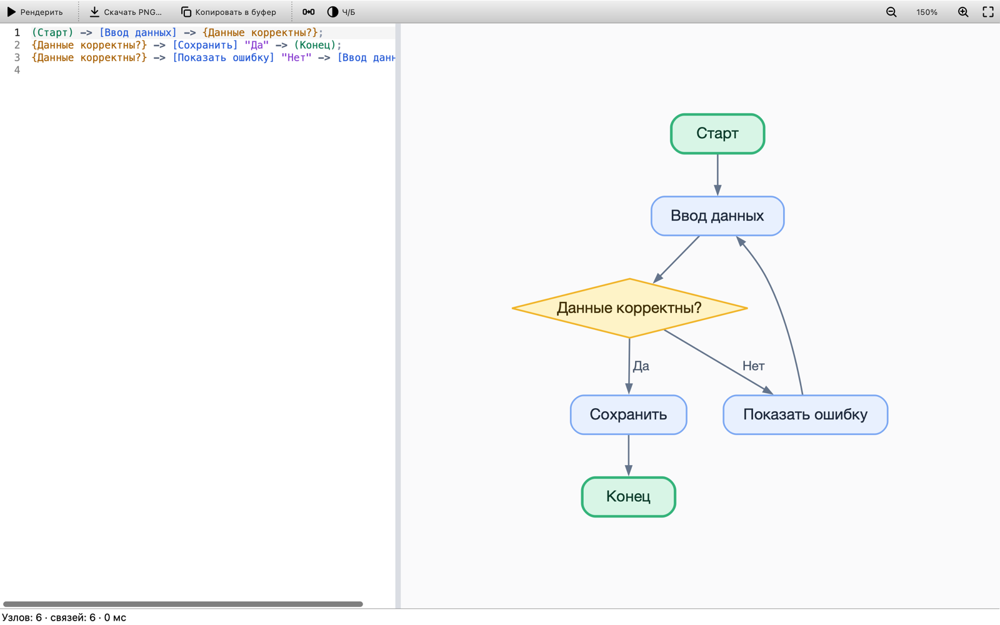
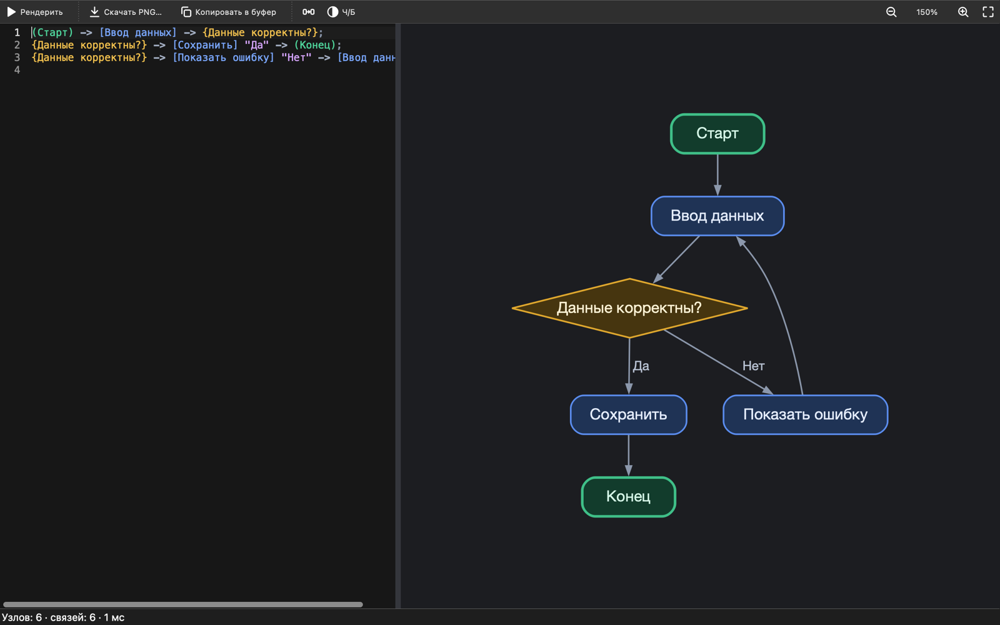
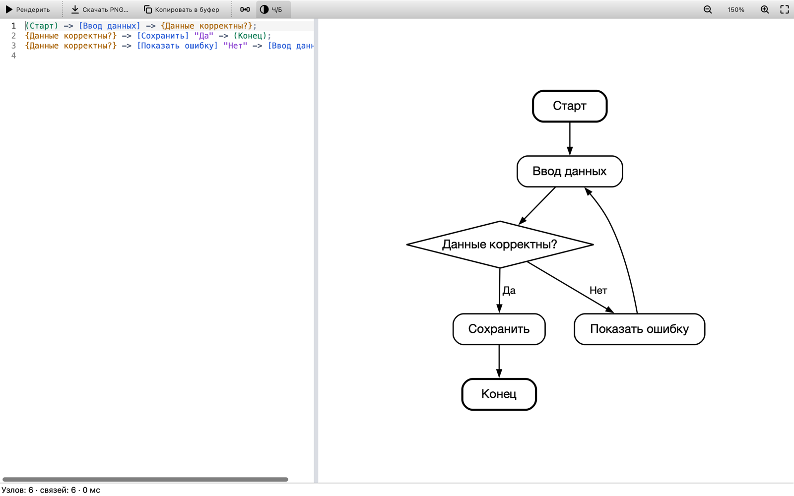
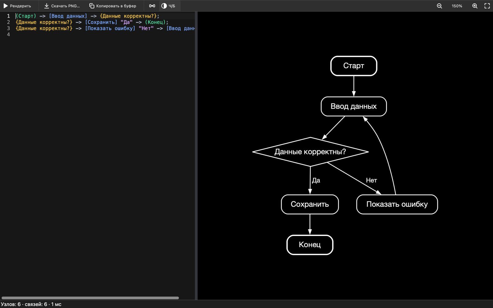

# Birch

[Русский](README.md) · **English**

An app for **macOS, Windows and Linux** that draws flowcharts from a text description. No AI and no internet: the text is read by Birch's own parser, the layout and arrows come from [Graphviz](https://graphviz.org), and the interface is built with Qt 6.

| Light theme | Dark theme |
|---|---|
|  |  |
| **Light theme, B/W** | **Dark theme, B/W** |
|  |  |

The app looks the same on macOS, Windows and Linux.

```text
(Start) -> [Enter data] -> {Data valid?};
{Data valid?} -> [Save] "Yes" -> (End);
{Data valid?} -> [Show error] "No" -> [Enter data];
```

## Features

- Editor on the left, diagram on the right. The diagram redraws itself 300 ms after you stop typing; rendering runs in a background thread, so typing never stalls.
- Errors are underlined right in the text, with the line, position and a clear message. An unfinished line doesn't break the rest of the diagram.
- **Find and replace** (⌘F / Ctrl+F) in a bar under the editor: every match is highlighted, with a “3 of 7” counter, case sensitivity and regular expressions. “Replace All” is undone with a single ⌘Z / Ctrl+Z — handy for renaming a block on every line at once.
- Vector canvas: zoom with ⌘/Ctrl + wheel or a trackpad pinch, scroll by dragging, double-click to fit the diagram to the window.
- **Save PNG** and **Copy to Clipboard**: paste the picture straight into Telegram, Slack, Word or Discord. SVG export and a transparent background are available too.
- **Black and white mode** (the “B/W” button): black lines and text on white, for printing and documents.
- **Mermaid export** (File menu): the diagram as text that GitHub, GitLab, Notion and Obsidian draw on their own. “Copy as Mermaid” puts a ready ` ```mermaid ` block on the clipboard, ready to paste into a README. Frames become `subgraph`s; colors are not carried over — Mermaid colors the diagram to match the site's theme.
- **Command-line rendering** without a window: `birch diagram.birch -o diagram.svg` — for scripts, Makefiles and CI (see [below](#command-line)).
- Light and dark themes follow the system; you can also pick one by hand. The picture theme can be set separately, for example always light for documents.
- **Russian and English interface**, chosen from the system language; switch it in **View → Language** (see [Interface language](#interface-language)).
- `.birch` files open with a double-click. Unsaved text is restored on the next launch.

## Installation

All packages are on the [Releases](https://github.com/empmaynmtusrgdyt/Birch/releases) page.

| System | File | How to install |
|---|---|---|
| macOS 15+ (Apple Silicon) | `Birch-<version>-macos-arm64.dmg` | open it and drag Birch to Applications |
| Windows 10/11 (x64) | `Birch-<version>-windows-x64.exe` | run the installer |
| Windows, no installation | `Birch-<version>-windows-x64.zip` | unpack, run `bin\Birch.exe` |
| Windows 8.1 (x64) | `Birch-<version>-windows8-x64.exe` or `.zip` | same as Windows 10/11 |
| Debian 13 | `birch_<version>_amd64_debian13.deb` | `sudo apt install ./birch_*_debian13.deb` |
| Ubuntu 26.04 | `birch_<version>_amd64_ubuntu26.04.deb` | `sudo apt install ./birch_*_ubuntu26.04.deb` |
| Arch Linux, Manjaro | `birch-<version>-1-x86_64.pkg.tar.zst` | `sudo pacman -U birch-*.pkg.tar.zst` |
| Other Linux (Ubuntu 22.04/24.04, Debian 12, Fedora…) | `Birch-<version>-x86_64.AppImage` | `chmod +x Birch-*.AppImage` and run it |

Details for each system:

- **macOS.** The app is signed ad-hoc rather than with an Apple Developer ID certificate, so macOS blocks it on first launch. Open it from the context menu → **Open**, or run `xattr -dr com.apple.quarantine /Applications/Birch.app`.
- **Windows.** The installer isn't signed with a certificate, so SmartScreen may show “Windows protected your PC”: click **More info → Run anyway**. The installer creates Start menu and desktop shortcuts and associates `.birch` files with Birch.
- **Windows 8.1.** Qt 6 officially supports only Windows 10 and later, so there is a separate `windows8` package: its Qt libraries are replaced with builds patched by the [qt6windows7](https://github.com/crystalidea/qt6windows7) project, and the C runtime (UCRT) ships next to the app. Otherwise it is the same as the regular package. On Windows 10/11, use the regular package.
- **Arch.** You can build the package yourself: download [`packaging/arch/PKGBUILD`](packaging/arch/PKGBUILD) and run `makepkg -si`.
- **AppImage.** Qt and Graphviz are inside the file, so it works even where the system Qt is older than 6.5. If it fails to start with a FUSE error, install `libfuse2t64` (Ubuntu 24.04) or `libfuse2` (22.04), or run it with `--appimage-extract-and-run`.

## Syntax

| Notation | Meaning |
|---|---|
| `[Text]` | step (rounded rectangle) |
| `{Condition?}` | decision (diamond) |
| `(Start)` | start or end |
| `[A] -> [B]` | arrow; chains work too: `[A] -> [B] -> [C]` |
| `[A] -> [B] "Yes"` | label of the arrow leading into `[B]` |
| `;` or a line break | end of statement; a line starting with `->` continues the previous one |
| `// …` or `# …` | comment |
| `\n` | line break inside text |
| `\]`, `\"`, `\\` | the character itself |
| `=Frame=` on its own line | open a frame; `==` on its own line closes it |
| `=Frame= [A]` | block `[A]` from the frame “Frame”; `== [A]` is a shared block outside frames |

Text inside brackets and quotes is taken as is: spaces stay spaces and `_` stays an underscore, for example `[snake_case]`. The same text means the same node. If a node is written as `{…}` or `(…)` at least once, it keeps that shape even if it is later written as `[…]`. The `→` arrow and the `«»` and `“”` quotes (inserted by autocorrect) are supported too.

### Frames

A frame draws a box around several blocks and labels them — useful for showing the parts of a large diagram. Frames are optional: a diagram without them is drawn as before.

```text
=Login=
[Enter password] -> {Check error}
{Check error} -> == (Exit) "Error"
[Enter password] -> =Loading= [Load profile] "Signed in"

=Loading=
[Load profile] -> {Check error}
{Check error} -> == (Exit) "Error"
```

- **Open and close.** `=Title=` on its own line opens a frame, which lasts until the next title; `==` closes it. Spaces around the equals signs don't matter: `= Login =` is the same frame.
- **A block belongs to where it is written.** Each frame has its own blocks: “Check error” above is two different blocks, one in each frame. Blocks outside frames are shared.
- **A block from elsewhere is named explicitly:** `=Loading= [Load profile]` is the block from the “Loading” frame, `== (Exit)` is a shared block. This is how arrows go between frames and to shared blocks. A shared block mentioned via `==` doesn't need a separate declaration.
- **Line order doesn't matter:** an arrow into a frame can come before the frame itself.

A ready-made example: **File → Open Frames Example**.

## Keyboard shortcuts

| macOS | Windows, Linux | Action |
|---|---|---|
| ⌘↩ or ⌘R | Ctrl+Enter or Ctrl+R | redraw the diagram |
| ⌘E | Ctrl+E | save PNG |
| ⌘⇧C | Ctrl+Shift+C | copy the picture to the clipboard |
| ⌘⇧B | Ctrl+Shift+B | black and white mode |
| ⌘+ / ⌘− | Ctrl++ / Ctrl+− | zoom |
| ⌘0 | Ctrl+0 | actual size |
| ⌘9 | Ctrl+9 | fit to window |
| ⌘S / ⌘O / ⌘N | Ctrl+S / Ctrl+O / Ctrl+N | save / open / new file |
| ⌘F | Ctrl+F | find |
| ⌥⌘F | Ctrl+H | find and replace |
| ⌘G / ⇧⌘G | F3 / Shift+F3 or Ctrl+G / Ctrl+Shift+G | next / previous match |
| ↩ / ⇧↩ in the search field | Enter / Shift+Enter in the search field | next / previous match |
| Esc | Esc | close the search bar |

In regular expression mode the replacement can refer to captured groups: `$1`, `$2`… (`$0` is the whole match, `$$` is a literal `$`), and `\n` inserts a line break.

## Interface language

Birch speaks Russian and English. By default it follows the system language; if the system language is neither, the interface is in English. To pick a language by hand, use **View → Language**; the change takes effect after a restart.

For the command line, or to override everything for one launch, set the `BIRCH_LANGUAGE` environment variable:

```bash
BIRCH_LANGUAGE=en birch --help
BIRCH_LANGUAGE=ru birch diagram.birch -o diagram.png
```

The command line follows the system language (`LANGUAGE`, `LC_ALL`, `LC_MESSAGES` and `LANG` on Linux, the system settings on macOS and Windows) and `BIRCH_LANGUAGE`, but not the menu setting, so a script gives the same output for every user of the machine.

**Adding a language** takes one file. `translations/update.sh de` creates `translations/birch_de.ts` with every interface string; translate it in Qt Linguist (or any editor) and rebuild — the build picks the file up, and the language appears in the menu on its own, together with Qt's own translation of standard dialogs if Qt has one. The source strings in the code are Russian. After changing strings in the code, run `translations/update.sh` again; `translations/update.sh --check` (run by CI) fails if a translation is out of date or unfinished.

## Command line

With `-o`, Birch draws the diagram to a file and exits right away without opening a window. The format is chosen by the extension: `.png`, `.svg` or `.mmd` (Mermaid). No display is needed — the command works over SSH, in cron and in CI.

```bash
birch diagram.birch -o diagram.png              # PNG, scale 2
birch diagram.birch -o diagram.svg -t dark      # dark theme
birch diagram.birch -o diagram.png -ma -s 3     # B/W, transparent, scale 3
birch diagram.birch -o diagram.mmd -H           # Mermaid, left to right
cat diagram.birch | birch - -o diagram.svg      # diagram text from stdin
birch diagram.birch                             # no -o: open in the editor
```

| Option | What it does |
|---|---|
| `-o, --output=FILE` | save the diagram to FILE and exit |
| `-t, --theme=THEME` | theme: `light` (default) or `dark` |
| `-m, --monochrome` | black and white diagram |
| `-H, --horizontal` | blocks from left to right |
| `-a, --transparent` | transparent background (PNG and SVG) |
| `-s, --scale=N` | PNG scale from 1 to 10 (default 2) |
| `-h, --help` | help |
| `-v, --version` | version |

The picture options (`-t`, `-m`, `-H`, `-a`, `-s`) only work together with `-o`. Short options without a value can be combined: `-ma` is the same as `-m -a`.

Errors in the diagram are printed to stderr in a format editors and CI understand, and no file is created:

```
diagram.birch:1:8: error: Unclosed “[” — expected “]” before the end of the line
```

| Exit code | Meaning |
|---|---|
| `0` | done |
| `1` | the diagram text has errors, or the diagram is empty |
| `2` | a file could not be read or written |
| `3` | invalid options |

A Makefile example — every diagram in `docs/` to SVG:

```make
docs/%.svg: docs/%.birch
	birch $< -o $@
```

How to get the `birch` command:

| System | What to do |
|---|---|
| Windows (installer) | nothing: the command works right away in a new cmd or PowerShell window |
| Debian, Ubuntu, Arch | nothing: the command is there as soon as the package is installed |
| macOS | once: menu **Birch → Install birch Command…** (asks for an administrator password) |
| AppImage | once: menu **Help → Install birch Command…** |

Details:

- **Windows.** The installer puts a small console `birch.com` next to the app and adds its folder `C:\Program Files\Birch\cmd` to PATH; uninstalling Birch removes it from PATH. The console waits until the diagram is drawn and gets the exit code (`$LASTEXITCODE` in PowerShell, `%ERRORLEVEL%` in cmd). `birch diagram.birch` without `-o` opens the window and returns the console right away. For the portable version (`.zip`), add the command yourself: `powershell -ExecutionPolicy Bypass -File birch-path.ps1` in the app folder.
- **macOS.** The menu item creates a link `/usr/local/bin/birch` to the program inside `Birch.app`. Before that, Birch must be in Applications and have been opened at least once via Open. The manual equivalent: `sudo ln -sf /Applications/Birch.app/Contents/MacOS/Birch /usr/local/bin/birch`.
- **AppImage.** The menu item creates a link `~/.local/bin/birch` to the AppImage file; no password needed. If you move the file, choose the item again. If `~/.local/bin` isn't in PATH, the app tells you what to add to `~/.bashrc`.

## Building from source

You need a C++20 compiler, CMake ≥ 3.21, **Qt ≥ 6.5** (Base, Svg and Linguist Tools) and Graphviz ≥ 2.42 with development headers. Each system has a CMake preset (`CMakePresets.json`).

### macOS (Homebrew)

```bash
xcode-select --install
brew install cmake qt graphviz

cmake --preset macos && cmake --build --preset macos && ctest --preset macos
open build/macos/Birch.app
```

### Debian 13, Ubuntu 26.04

```bash
sudo apt install build-essential cmake pkg-config qt6-base-dev qt6-svg-dev \
                 qt6-qpa-plugins libgl-dev libgraphviz-dev graphviz \
                 qt6-tools-dev qt6-l10n-tools qt6-translations-l10n

cmake --preset linux && cmake --build --preset linux && ctest --preset linux
./build/linux/birch
```

### Arch Linux

```bash
sudo pacman -S --needed base-devel cmake qt6-base qt6-svg qt6-tools qt6-translations graphviz

cmake --preset linux && cmake --build --preset linux && ctest --preset linux
./build/linux/birch
```

### Windows

1. Install [Visual Studio 2022](https://visualstudio.microsoft.com/) with the “Desktop development with C++” workload.
2. Install Qt 6.8 for MSVC 2022 64-bit with the [Qt Online Installer](https://www.qt.io/download-qt-installer) or `pip install aqtinstall && aqt install-qt windows desktop 6.8.3 win64_msvc2022_64`.
3. Download the official MSVC build of Graphviz — the `windows_10_cmake_Release_Graphviz-<version>-win64.zip` archive from the [download page](https://graphviz.org/download/) — and unpack it.
4. Build in “Developer PowerShell for VS 2022”:

```powershell
$env:GRAPHVIZ_ROOT = "C:\Graphviz-16.1.0-win64"
$env:PATH = "C:\Qt\6.8.3\msvc2022_64\bin;$env:GRAPHVIZ_ROOT\bin;$env:PATH"   # for tests and running
cmake --preset windows -DCMAKE_PREFIX_PATH=C:\Qt\6.8.3\msvc2022_64
cmake --build --preset windows
ctest --preset windows
.\build\windows\Release\Birch.exe
```

During configuration CMake prints a line like `Birch 0.3.0: Qt 6.9.3, Graphviz 16.1.0, builtin plugins: TRUE`. `builtin plugins: TRUE` means the Graphviz plugins are built into the app (as on macOS, Windows and in the AppImage). The Debian, Ubuntu and Arch packages use the plugins of the system Graphviz.

Tests (parser, renderer, Mermaid export, search and languages, about 100 checks) are built by default; turn them off with `-DBIRCH_BUILD_TESTS=OFF`.

## Packages

| System | Command | Result |
|---|---|---|
| macOS | `cd build/macos && cpack` | `.dmg` |
| Debian, Ubuntu | `cd build/linux && cpack -G DEB` | `.deb` (dependencies detected automatically) |
| Arch | `cd packaging/arch && makepkg` | `.pkg.tar.zst` |
| Any Linux | `./packaging/linux/build-appimage.sh` | `.AppImage` (build it on the oldest supported system) |
| Windows | `cd build\windows && cpack -C Release` | `.zip`, plus an `.exe` installer if [NSIS](https://nsis.sourceforge.io) is installed |

What packaging does:

- **macOS.** `macdeployqt` copies Qt and every library, Graphviz included, into `Birch.app`. Then `packaging/macos/prune-bundle.cmake` removes what isn't needed, adds what `macdeployqt` missed and **checks that the bundle is self-contained**: if a library is missing, packaging fails. Finally, an ad-hoc signature.
- **Windows.** `windeployqt` copies Qt; only the 10 needed Graphviz DLLs (about 1.4 MB) are taken instead of the ~60 in the official build; the MSVC runtime goes next to the app.
- **Windows 8.1.** The same, but with `-DBIRCH_QT_WINDOWS8_DIR=<folder>` (an unpacked [qt6windows7](https://github.com/crystalidea/qt6windows7/releases) archive for the same Qt version): `packaging/windows/replace-qt.cmake` swaps the Qt libraries for it, and the UCRT is added to the package. In CI, `.github/scripts/check-win81.py` reads the import tables of every `.exe` and `.dll` in the package and checks that nothing needs functions newer than Windows 8.1 and that the swapped Qt matches the build. CI has no Windows 8.1 machines, so running on Windows 8.1 itself is checked by hand.
- **Linux.** The standard `/usr` layout: the `birch` binary, a `.desktop` file, an icon, a MIME type for `.birch`.
- **Library licenses.** The macOS and AppImage packages collect the licenses of every bundled library automatically: `packaging/macos/collect-licenses.cmake` takes them from Homebrew packages, `packaging/linux/collect-licenses.sh` from Ubuntu packages; a summary goes to `LIBRARIES.txt` next to the texts. For Windows, `.github/scripts/check-windows-licenses.py` checks that every DLL is described in `THIRD-PARTY-NOTICES.txt`. A library without a license fails the build.

## Continuous integration and releases

On every push, GitHub Actions (`.github/workflows/ci.yml`) builds Birch on macOS, Debian 13, Ubuntu 26.04, Arch Linux and Windows, runs the tests, builds every package and checks them for real:

- the `.deb` is installed with `apt` into clean Debian 13 and Ubuntu 26.04;
- the Arch package is built with `makepkg` and installed with `pacman`;
- the Windows installer runs in silent mode, then the installed `Birch.exe` starts with a clean `PATH`;
- the Windows 8.1 package is checked by its import tables (nothing newer than Windows 8.1) and is installed and launched on Windows 10 the same way;
- the app from the `.dmg` runs straight from the mounted image;
- the AppImage runs under Xvfb.

Each launch uses the hidden option `Birch --screenshot out.png [file.birch]`: the app waits for the diagram's first render, saves a screenshot of the window and exits with code 0 (or non-zero on error). Screenshots from every system are kept as run artifacts.

**Release:** bump the version in `CMakeLists.txt` (and `pkgver` in `PKGBUILD`) and push a `vX.Y.Z` tag — CI builds and checks everything and creates a draft release with every package and `SHA256SUMS.txt`.

## Project layout

```text
Birch/
├── CMakeLists.txt            build: birch_core and Birch targets, per-OS settings
├── CMakePresets.json         macos / linux / windows presets (configure, build, test)
├── .github/workflows/ci.yml  CI for every OS and releases on tags
├── cmake/
│   ├── FindGraphviz.cmake    finds Graphviz: pkg-config, then by hand
│   ├── Packaging.cmake       common CPack settings
│   └── Packaging{MacOS,Linux,Windows}.cmake
├── src/
│   ├── main.cpp
│   ├── core/                 logic without widgets, covered by tests
│   │   ├── Diagram.h         model: nodes, edges, shapes, frames
│   │   ├── Language.*        interface language choice, loading translations
│   │   ├── MermaidExporter.* Diagram → Mermaid text
│   │   ├── Parser.*          DSL → Diagram, errors with positions
│   │   ├── Renderer.*        Diagram → Graphviz (cgraph + dot) → SVG → QImage/PNG
│   │   └── Theme.*           color (light, dark) and B/W palettes, per-OS fonts
│   ├── app/
│   │   └── RenderController.*  background rendering, “last request wins”
│   └── ui/
│       ├── MainWindow.*      window, menus, export, files, themes
│       ├── CodeEditor.*      editor: line numbers, error underlines, search highlights
│       ├── FindBar.*         find and replace bar
│       ├── SyntaxHighlighter.*
│       └── PreviewView.*     interactive canvas (vector, zoom, scrolling)
├── resources/                interface icons, example diagrams
├── translations/             interface translations (Qt Linguist) and update.sh
├── packaging/
│   ├── macos/                Info.plist, icon, bundle check
│   ├── windows/              .rc with icon and version, app.ico
│   ├── linux/                .desktop, MIME type, AppImage build
│   ├── arch/                 PKGBUILD
│   └── generate-icons.sh     app.svg → app.icns and app.ico
├── tests/                    parser, renderer, Mermaid export, search and language tests (Qt Test)
└── docs/                     screenshots
```

### How rendering works

1. `Parser` turns the text into a `Diagram` and a list of errors. A statement is applied whole or not at all, so the diagram doesn't “flicker” while you type.
2. `Renderer` builds a graph through the Graphviz C++ API (`cgraph`), sets styles with attributes from `Theme`, lays the graph out with the `dot` engine and gets SVG via `gvRenderData`.
3. Text width for Graphviz is measured by Qt, with the same font the SVG is later drawn in: Birch registers its own `textlayout` plugin with Graphviz. Without it Graphviz estimates widths from a built-in table, and Cyrillic text spills out of the nodes.
4. The preview shows the SVG as vectors (`QGraphicsSvgItem`), and export rasterizes it to PNG at 2× for HiDPI.

## Troubleshooting

| Symptom | What to do |
|---|---|
| `Could NOT find Graphviz` | Install the development package (`libgraphviz-dev`, `graphviz` on Arch, `brew install graphviz`) or give the path: `-DGRAPHVIZ_ROOT=…`. |
| `Could NOT find Qt6Svg` / `SvgWidgets` | Install the SVG module: `qt6-svg-dev`, `qt6-svg`, or “Qt SVG” in the Qt installer. |
| `Could NOT find Qt6LinguistTools` | Install the Qt translation tools: `qt6-tools-dev qt6-l10n-tools` (Debian, Ubuntu), `qt6-tools` (Arch); Homebrew's `qt` already has them. |
| `Could NOT find Qt6 … version 6.5` | The system Qt is too old (Ubuntu 24.04, Debian 12): install Qt with the Qt Online Installer or aqtinstall and pass `-DCMAKE_PREFIX_PATH=…`, or use the AppImage. |
| “Layout type: "dot" not recognized” | Graphviz plugins not found: install the `graphviz` package and run `sudo dot -c`. |
| Linux: “could not load the Qt platform plugin "xcb"” | Debian/Ubuntu: `sudo apt install qt6-qpa-plugins`; for the AppImage on Ubuntu 22.04/24.04, `sudo apt install libxcb-cursor0`. |
| Windows: `Qt6Core.dll` or `gvc.dll` missing at launch | To run from the build folder, add the Qt and Graphviz `bin` folders to `PATH`; the installed package contains everything itself. |
| CMake changes have no effect | Option values are cached: pass them explicitly or delete the `build/<preset>` folder. |

The app icons (`packaging/macos/app.icns`, `packaging/windows/app.ico`) are generated from `resources/icons/app.svg` by `packaging/generate-icons.sh`.

## License

Birch is distributed under the [Mozilla Public License 2.0](LICENSE).

In short:

- You can use Birch for free for any purpose, including at work and in commercial projects.
- You can copy, modify and distribute the code, including as part of your own programs, even closed-source ones.
- If you distribute Birch with modified **Birch files**, the source of those files must be made available under the same MPL 2.0. Your own new files can be under any license.
- Copyright and license notices must be kept. There is no warranty.

The packages include libraries from other projects: [Qt](https://www.qt.io) (LGPL v3) and [Graphviz](https://graphviz.org) (Eclipse Public License 2.0). Both licenses are compatible with MPL 2.0. Details and links to the source code are in [THIRD-PARTY-NOTICES.txt](THIRD-PARTY-NOTICES.txt), and the license texts are in the [licenses](licenses) folder.

Up to and including version 0.8.1, Birch was distributed under the GNU GPL v3 with an additional permission for Graphviz; those versions remain under that license.

If you send changes to Birch, you agree to distribute them under MPL 2.0.
