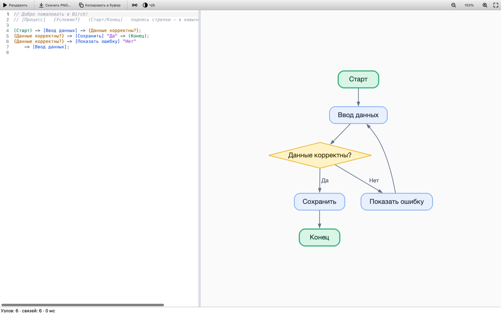
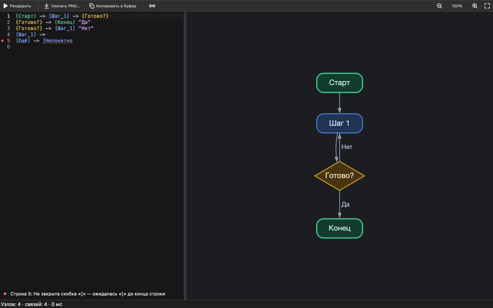
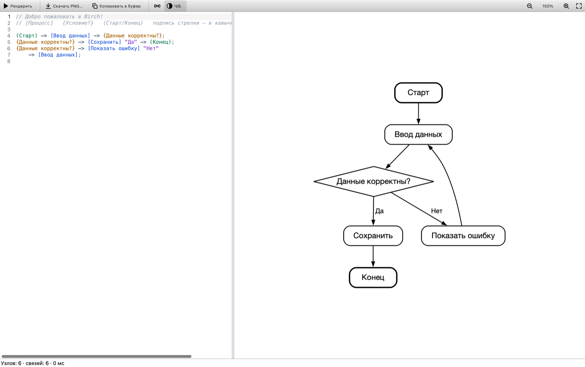
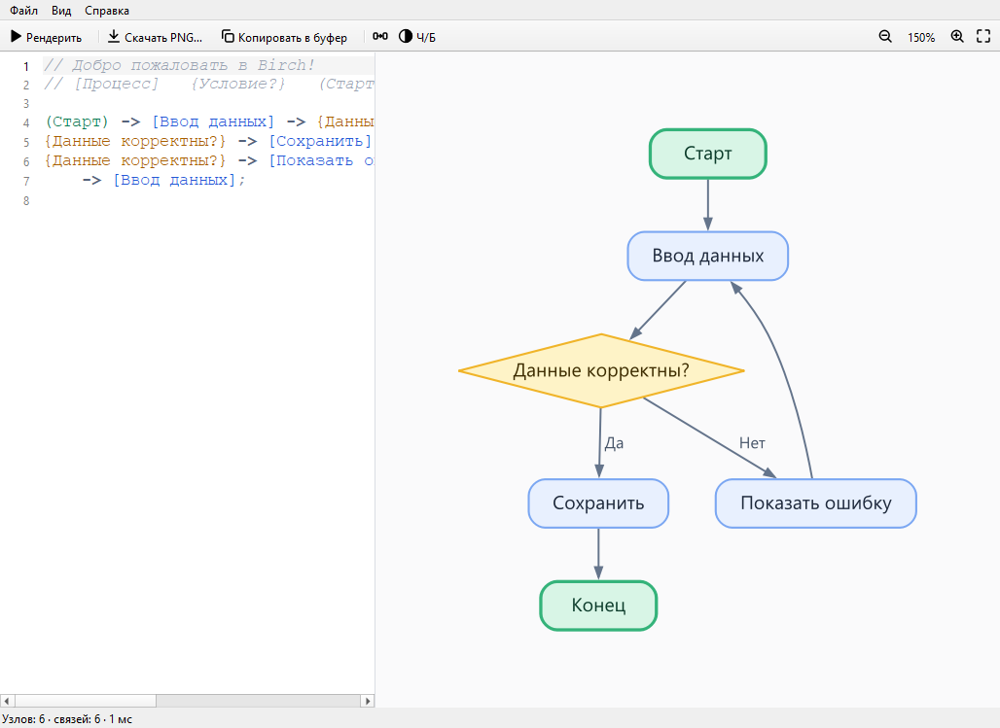
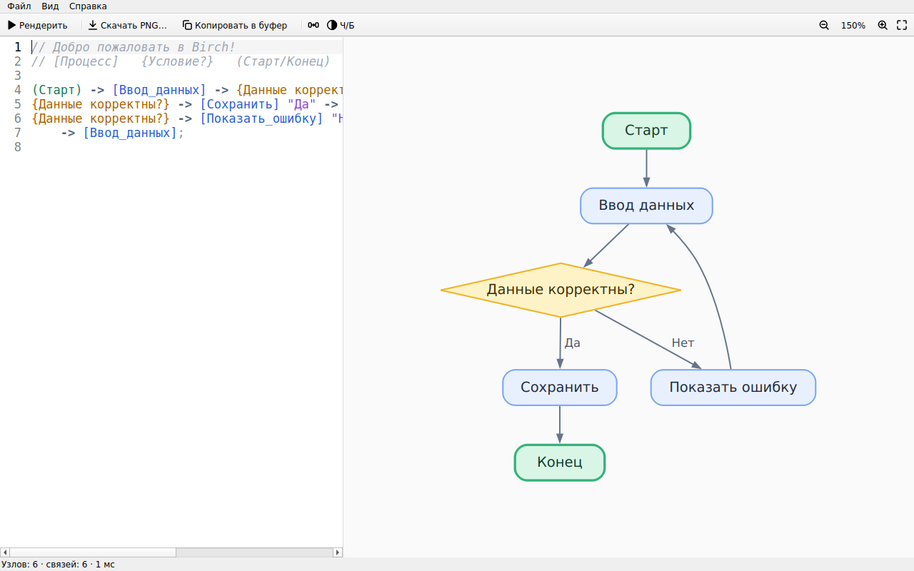

# Birch

Приложение для **macOS, Windows и Linux**, которое строит блок-схемы по текстовому описанию. Без ИИ и без интернета: текст разбирает собственный парсер, раскладку и стрелки делает [Graphviz](https://graphviz.org), интерфейс написан на Qt 6.



```text
(Старт) -> [Ввод_данных] -> {Данные корректны?};
{Данные корректны?} -> [Сохранить] "Да" -> (Конец);
{Данные корректны?} -> [Показать_ошибку] "Нет" -> [Ввод_данных];
```

## Возможности

- Редактор слева, схема справа. Схема перерисовывается автоматически через 300 мс после паузы в наборе; рендер идёт в фоновом потоке, поэтому набор не подвисает.
- Ошибки подчёркиваются прямо в тексте: строка, позиция и понятное сообщение. Недописанная строка не ломает остальную схему.
- Векторный холст: масштаб через ⌘/Ctrl + колесо или щипок на трекпаде, прокрутка перетаскиванием, двойной щелчок вписывает схему в окно.
- **Скачать PNG** и **Копировать в буфер**: картинку можно сразу вставить в Telegram, Slack, Word или Discord. Есть экспорт в SVG и прозрачный фон.
- **Чёрно-белый режим** (кнопка «Ч/Б»): чёрные линии и текст на белом, для печати и документов.
- Светлая и тёмная темы следуют системной; тему можно выбрать и вручную. Тему картинки можно задать отдельно, например всегда светлую для документов.
- Файлы `.birch` открываются двойным щелчком. Несохранённый текст восстанавливается при следующем запуске.

| Тёмная тема (macOS) | Чёрно-белый режим (macOS) |
|---|---|
|  |  |

| Windows | Linux (Ubuntu) |
|---|---|
|  |  |

## Установка

Все пакеты — на странице [Releases](https://github.com/empmaynmtusrgdyt/Birch/releases).

| Система | Файл | Как установить |
|---|---|---|
| macOS 15+ (Apple Silicon) | `Birch-<версия>-macos-arm64.dmg` | открыть и перетащить Birch в «Программы» |
| Windows 10/11 (x64) | `Birch-<версия>-windows-x64.exe` | запустить установщик |
| Windows, без установки | `Birch-<версия>-windows-x64.zip` | распаковать, запустить `bin\Birch.exe` |
| Debian 13 | `birch_<версия>_amd64_debian13.deb` | `sudo apt install ./birch_*_debian13.deb` |
| Ubuntu 26.04 | `birch_<версия>_amd64_ubuntu26.04.deb` | `sudo apt install ./birch_*_ubuntu26.04.deb` |
| Arch Linux, Manjaro | `birch-<версия>-1-x86_64.pkg.tar.zst` | `sudo pacman -U birch-*.pkg.tar.zst` |
| Другие Linux (Ubuntu 22.04/24.04, Debian 12, Fedora…) | `Birch-<версия>-x86_64.AppImage` | `chmod +x Birch-*.AppImage` и запустить |

Подробности для каждой системы:

- **macOS.** Приложение подписано ad-hoc, а не сертификатом Apple Developer ID, поэтому при первом запуске macOS его заблокирует. Откройте его через контекстное меню → **«Открыть»** или выполните `xattr -dr com.apple.quarantine /Applications/Birch.app`.
- **Windows.** Установщик не подписан сертификатом, поэтому SmartScreen может показать «Windows защитила ваш компьютер»: нажмите **«Подробнее» → «Выполнить в любом случае»**. Установщик создаёт ярлыки в «Пуске» и на рабочем столе и связывает файлы `.birch` с Birch.
- **Arch.** Пакет можно собрать и самостоятельно: скачайте [`packaging/arch/PKGBUILD`](packaging/arch/PKGBUILD) и выполните `makepkg -si`.
- **AppImage.** Qt и Graphviz находятся внутри файла, поэтому он работает и там, где системный Qt старше 6.5. Если файл не запускается с ошибкой про FUSE, установите `libfuse2t64` (Ubuntu 24.04) или `libfuse2` (22.04), либо запустите его с ключом `--appimage-extract-and-run`.

## Синтаксис

| Запись | Значение |
|---|---|
| `[Текст]` | шаг (скруглённый прямоугольник) |
| `{Условие?}` | решение (ромб) |
| `(Старт)` | начало или конец |
| `[A] -> [B]` | стрелка; можно цепочкой: `[A] -> [B] -> [C]` |
| `[A] -> [B] "Да"` | подпись стрелки, ведущей в `[B]` |
| `;` или перевод строки | конец инструкции; строка, начинающаяся с `->`, продолжает предыдущую |
| `// …` или `# …` | комментарий |
| `_` | пробел в тексте узла; `\_` — само подчёркивание |
| `\n` | перенос строки внутри текста |
| `\]`, `\"`, `\\` | символ как есть |

Одинаковый текст обозначает один и тот же узел. Если узел хоть раз записан как `{…}` или `(…)`, он остаётся этой фигурой, даже если дальше написан как `[…]`. Стрелка `→` и кавычки `«»` и `“”` (их подставляет автозамена) тоже поддерживаются.

## Горячие клавиши

| macOS | Windows, Linux | Действие |
|---|---|---|
| ⌘↩ или ⌘R | Ctrl+Enter или Ctrl+R | перерисовать схему |
| ⌘E | Ctrl+E | скачать PNG |
| ⌘⇧C | Ctrl+Shift+C | копировать картинку в буфер |
| ⌘⇧B | Ctrl+Shift+B | чёрно-белый режим |
| ⌘+ / ⌘− | Ctrl++ / Ctrl+− | масштаб |
| ⌘0 | Ctrl+0 | реальный размер |
| ⌘9 | Ctrl+9 | по размеру окна |
| ⌘S / ⌘O / ⌘N | Ctrl+S / Ctrl+O / Ctrl+N | сохранить / открыть / новый файл |

## Сборка из исходников

Нужны компилятор с C++20, CMake ≥ 3.21, **Qt ≥ 6.5** (модули Base и Svg) и Graphviz ≥ 2.42 с заголовками для разработки. Для каждой системы есть пресет CMake (`CMakePresets.json`).

### macOS (Homebrew)

```bash
xcode-select --install
brew install cmake qt graphviz

cmake --preset macos && cmake --build --preset macos && ctest --preset macos
open build/macos/Birch.app
```

### Debian 13, Ubuntu 26.04

```bash
sudo apt install build-essential cmake pkg-config qt6-base-dev qt6-svg-dev \
                 qt6-qpa-plugins libgl-dev libgraphviz-dev graphviz

cmake --preset linux && cmake --build --preset linux && ctest --preset linux
./build/linux/birch
```

### Arch Linux

```bash
sudo pacman -S --needed base-devel cmake qt6-base qt6-svg graphviz

cmake --preset linux && cmake --build --preset linux && ctest --preset linux
./build/linux/birch
```

### Windows

1. Установите [Visual Studio 2022](https://visualstudio.microsoft.com/) с рабочей нагрузкой «Разработка классических приложений на C++».
2. Установите Qt 6.8 для MSVC 2022 64-bit через [Qt Online Installer](https://www.qt.io/download-qt-installer) или `pip install aqtinstall && aqt install-qt windows desktop 6.8.3 win64_msvc2022_64`.
3. Скачайте официальную сборку Graphviz для MSVC — архив `windows_10_cmake_Release_Graphviz-<версия>-win64.zip` со [страницы загрузок](https://graphviz.org/download/) — и распакуйте.
4. Соберите в «Developer PowerShell for VS 2022»:

```powershell
$env:GRAPHVIZ_ROOT = "C:\Graphviz-16.1.0-win64"
$env:PATH = "C:\Qt\6.8.3\msvc2022_64\bin;$env:GRAPHVIZ_ROOT\bin;$env:PATH"   # для тестов и запуска
cmake --preset windows -DCMAKE_PREFIX_PATH=C:\Qt\6.8.3\msvc2022_64
cmake --build --preset windows
ctest --preset windows
.\build\windows\Release\Birch.exe
```

При настройке CMake печатает строку вида `Birch 0.3.0: Qt 6.9.3, Graphviz 16.1.0, builtin plugins: TRUE`. `builtin plugins: TRUE` означает, что плагины Graphviz встроены в приложение (так на macOS, Windows и в AppImage). В пакетах для Debian, Ubuntu и Arch используются плагины системного Graphviz.

Тесты (парсер и рендерер, около 50 проверок) собираются по умолчанию; отключаются флагом `-DBIRCH_BUILD_TESTS=OFF`.

## Пакеты

| Система | Команда | Результат |
|---|---|---|
| macOS | `cd build/macos && cpack` | `.dmg` |
| Debian, Ubuntu | `cd build/linux && cpack -G DEB` | `.deb` (зависимости определяются автоматически) |
| Arch | `cd packaging/arch && makepkg` | `.pkg.tar.zst` |
| Любой Linux | `./packaging/linux/build-appimage.sh` | `.AppImage` (собирайте на самой старой поддерживаемой системе) |
| Windows | `cd build\windows && cpack -C Release` | `.zip`, а при установленном [NSIS](https://nsis.sourceforge.io) — и установщик `.exe` |

Что делает упаковка:

- **macOS.** `macdeployqt` копирует Qt и все библиотеки, включая Graphviz, внутрь `Birch.app`. Затем `packaging/macos/prune-bundle.cmake` удаляет лишнее, докопирует то, что `macdeployqt` пропустил, и **проверяет, что бандл самодостаточен**: если какой-то библиотеки не хватает, упаковка завершится ошибкой. В конце — ad-hoc подпись.
- **Windows.** `windeployqt` копирует Qt; из Graphviz берутся только 10 нужных DLL (около 1,4 МБ) вместо ~60 из официальной сборки; среда выполнения MSVC кладётся рядом с программой.
- **Linux.** Стандартная раскладка `/usr`: бинарник `birch`, `.desktop`-файл, иконка, MIME-тип для `.birch`.

## Непрерывная интеграция и релизы

При каждом push GitHub Actions (`.github/workflows/ci.yml`) собирает Birch на macOS, Debian 13, Ubuntu 26.04, Arch Linux и Windows, прогоняет тесты, собирает все пакеты и проверяет их по-настоящему:

- `.deb` ставится через `apt` в чистые Debian 13 и Ubuntu 26.04;
- пакет Arch собирается `makepkg` и ставится через `pacman`;
- установщик Windows запускается в тихом режиме, затем установленный `Birch.exe` стартует с чистым `PATH`;
- приложение из `.dmg` запускается прямо из смонтированного образа;
- AppImage запускается в Xvfb.

Каждый запуск — это скрытая опция `Birch --screenshot out.png [файл.birch]`: приложение ждёт первой отрисовки схемы, сохраняет снимок окна и выходит с кодом 0 (или ненулевым при ошибке). Снимки со всех систем сохраняются как артефакты прогона.

**Релиз:** поднимите версию в `CMakeLists.txt` (и `pkgver` в `PKGBUILD`), отправьте тег `vX.Y.Z` — CI соберёт и проверит всё и создаст черновик релиза со всеми пакетами и `SHA256SUMS.txt`.

## Структура проекта

```text
Birch/
├── CMakeLists.txt            сборка: цели birch_core и Birch, настройки для каждой ОС
├── CMakePresets.json         пресеты macos / linux / windows (configure, build, test)
├── .github/workflows/ci.yml  CI для всех ОС и выпуск релизов по тегу
├── cmake/
│   ├── FindGraphviz.cmake    поиск Graphviz: pkg-config, затем вручную
│   ├── Packaging.cmake       общие настройки CPack
│   └── Packaging{MacOS,Linux,Windows}.cmake
├── src/
│   ├── main.cpp
│   ├── core/                 логика без виджетов, покрыта тестами
│   │   ├── Diagram.h         модель: узлы, связи, фигуры
│   │   ├── Parser.*          DSL → Diagram, ошибки с позициями
│   │   ├── Renderer.*        Diagram → Graphviz (cgraph + dot) → SVG → QImage/PNG
│   │   └── Theme.*           цветные (светлая, тёмная) и чёрно-белые палитры, шрифты для ОС
│   ├── app/
│   │   └── RenderController.*  фоновый рендер, «побеждает последний запрос»
│   └── ui/
│       ├── MainWindow.*      окно, меню, экспорт, файлы, темы
│       ├── CodeEditor.*      редактор: номера строк, подчёркивание ошибок
│       ├── SyntaxHighlighter.*
│       └── PreviewView.*     интерактивный холст (вектор, зум, прокрутка)
├── resources/                иконки интерфейса, пример схемы
├── packaging/
│   ├── macos/                Info.plist, иконка, проверка бандла
│   ├── windows/              .rc с иконкой и версией, app.ico
│   ├── linux/                .desktop, MIME-тип, сборка AppImage
│   ├── arch/                 PKGBUILD
│   └── generate-icons.sh     app.svg → app.icns и app.ico
├── tests/                    тесты парсера и рендерера (Qt Test)
└── docs/                     скриншоты
```

### Как устроен рендеринг

1. `Parser` превращает текст в `Diagram` и список ошибок. Инструкция применяется целиком или не применяется вовсе, поэтому при наборе схема не «мигает».
2. `Renderer` строит граф через C++ API Graphviz (`cgraph`), задаёт стили атрибутами из `Theme`, раскладывает граф движком `dot` и получает SVG через `gvRenderData`.
3. Ширину текста для Graphviz измеряет Qt, тем же шрифтом, которым потом рисуется SVG: в Graphviz зарегистрирован собственный плагин `textlayout`. Без него Graphviz оценивает ширину по встроенной таблице, и кириллица вылезает за рамки узлов.
4. Превью показывает SVG как вектор (`QGraphicsSvgItem`), а экспорт растеризует его в PNG с масштабом 2× для HiDPI.

## Решение проблем

| Симптом | Что делать |
|---|---|
| `Could NOT find Graphviz` | Установите пакет для разработки (`libgraphviz-dev`, `graphviz` в Arch, `brew install graphviz`) или укажите путь: `-DGRAPHVIZ_ROOT=…`. |
| `Could NOT find Qt6Svg` / `SvgWidgets` | Установите модуль SVG: `qt6-svg-dev`, `qt6-svg`, в установщике Qt — «Qt SVG». |
| `Could NOT find Qt6 … version 6.5` | Системный Qt слишком старый (Ubuntu 24.04, Debian 12): поставьте Qt через Qt Online Installer или aqtinstall и передайте `-DCMAKE_PREFIX_PATH=…`, или используйте AppImage. |
| «Layout type: "dot" not recognized» | Не найдены плагины Graphviz: установите пакет `graphviz` и выполните `sudo dot -c`. |
| Linux: «could not load the Qt platform plugin "xcb"» | Debian/Ubuntu: `sudo apt install qt6-qpa-plugins`; для AppImage на Ubuntu 22.04/24.04 — `sudo apt install libxcb-cursor0`. |
| Windows: при запуске не хватает `Qt6Core.dll` или `gvc.dll` | Для запуска из папки сборки добавьте в `PATH` папки `bin` Qt и Graphviz; установленный пакет содержит всё сам. |
| После смены параметров CMake ничего не меняется | Значения опций кэшируются: передайте их явно или удалите папку `build/<пресет>`. |

Иконки приложения (`packaging/macos/app.icns`, `packaging/windows/app.ico`) генерируются из `resources/icons/app.svg` скриптом `packaging/generate-icons.sh`.

## Лицензия

Birch распространяется по лицензии [GNU General Public License v3.0](LICENSE) с [дополнительным разрешением](LICENSE-EXCEPTION) по разделу 7 GPLv3 на связывание с Graphviz. Оба текста входят во все пакеты.

Зачем нужно разрешение: Birch использует [Graphviz](https://graphviz.org), который распространяется под Eclipse Public License 1.0, а она несовместима с GPL. В готовые пакеты для macOS, Windows и AppImage библиотеки Graphviz входят в составе приложения, и разрешение явно позволяет распространять такое объединение. Исходный код используемых частей Graphviz доступен на [gitlab.com/graphviz/graphviz](https://gitlab.com/graphviz/graphviz).

Также используется [Qt](https://www.qt.io) под LGPL v3, она совместима с GPL v3.

Если вы присылаете изменения в Birch, вы соглашаетесь распространять их на тех же условиях, включая дополнительное разрешение.
