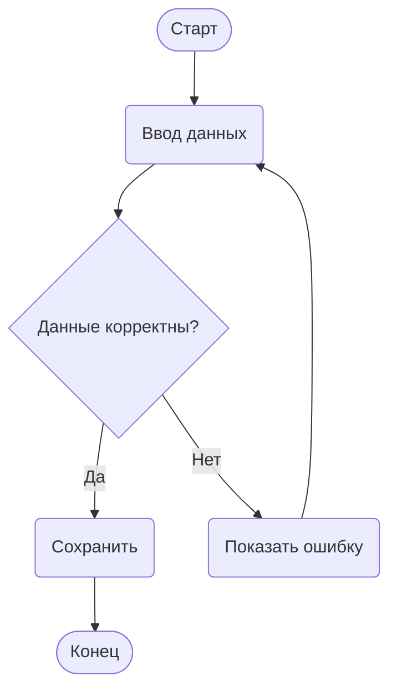

# TODO

Планы развития Birch. Каждый пункт описан так, чтобы его можно было взять в работу:
что меняется для пользователя, как это устроено внутри, какие есть спорные места
и как проверить, что всё работает.

| № | Идея | Сложность | Зависит от |
|---|---|---|---|
| 1 | [Группы-рамки](#1-группы-рамки) | средняя | — |
| 2 | [Поиск и замена](#2-поиск-и-замена) | низкая | — |
| 3 | [Экспорт в Mermaid](#3-экспорт-в-mermaid) | низкая | лучше после 1 |
| 4 | [Рендер из командной строки](#4-рендер-из-командной-строки) | средняя | лучше после 3 |
| 5 | [Английский интерфейс](#5-английский-интерфейс) | средняя | лучше последним |

**Предлагаемый порядок: 2 → 1 → 3 → 4 → 5.**

- **Поиск и замена** — самая простая задача, она ни на что не влияет.
- **Группы** меняют синтаксис, поэтому экспорт в Mermaid и командную строку стоит делать после них. Тогда группы сразу будут поддерживаться везде.
- **Перевод интерфейса** лучше делать последним, чтобы переводить уже все новые строки, а не возвращаться к нему после каждой функции.

---

## 1. Группы-рамки

### Зачем

В большой схеме трудно понять, из каких частей состоит процесс. Например: авторизация, загрузка данных, обработка ошибок. Группа обводит несколько блоков рамкой с заголовком.

Если разрезать схему на несколько отдельных, пропадут стрелки между частями. С группами схема остаётся одной: стрелки свободно пересекают границы рамок.

Группы полностью **необязательны**. Если в тексте нет ни одного заголовка, схема рисуется как сейчас, и старые файлы не меняются.

### Синтаксис

Фигурные скобки `{…}` уже означают ромб, поэтому запись `группа "Авторизация" { … }` путала бы. Вместо неё предлагаются строки-заголовки:

```
== Авторизация ==
[Ввод пароля] -> {Пароль верный?}
{Пароль верный?} -> [Показать ошибку] "Нет" -> [Ввод пароля]

== Загрузка ==
[Открыть профиль] -> [Загрузить настройки]

== ==
{Пароль верный?} -> [Открыть профиль] "Да"
[Загрузить настройки] -> (Готово)
```

У такой записи есть ещё один плюс: в ней нет ключевых слов на каком-либо языке. Синтаксис Birch и сейчас состоит только из скобок и символов, поэтому с английским интерфейсом (пункт 5) его не придётся переводить.

### Правила

- **`== Название ==`** — строка-заголовок. Она открывает группу, которая действует до следующего заголовка или до конца файла.
- **`== ==`** — пустой заголовок. Он закрывает текущую группу, и дальше блоки идут без рамки.
- **Принадлежность блока.** Блок попадает в группу, в которой он упомянут впервые. Позже на него можно ссылаться откуда угодно, например в стрелках между группами, и он останется в своей рамке.
- **Повтор заголовка.** Тот же заголовок ещё раз продолжает ту же группу, второй рамки не будет. Так группу можно дописывать в разных частях файла.
- **Пустая группа.** Группа без блоков не рисуется.
- **Вложенность.** Её нет: группа внутри группы сильно усложняет синтаксис ради редкого случая.
- **Пробелы.** Они вокруг названия игнорируются, а `\n` в названии даёт перенос строки, как в блоках.
- **Ошибки с подчёркиванием в тексте:**
  - строка вида `== Название` без закрывающих `==`;
  - слишком длинное название (тот же лимит, что у текста блока).

### Внешний вид

- **Рамка.** Тонкая и скруглённая, слегка подкрашенный фон, заголовок в левом верхнем углу мелким полужирным шрифтом.
- **Светлая и тёмная тема.** Рамка и фон в приглушённых цветах темы, чтобы не спорить с цветами блоков.
- **Чёрно-белый режим.** Чёрная рамка, белый фон, чёрный заголовок.
- **Горизонтальная схема.** Работает так же.
- **Редактор.** Строки-заголовки подсвечиваются отдельным цветом, чтобы структура файла была видна сразу.

### Как устроено

- **Парсер (`src/core/Parser.cpp`).** Нужен новый токен «заголовок группы». Его распознаёт строка, которая после пробелов начинается с `==`. Парсер помнит текущую группу и при первом упоминании блока записывает её в узел.
- **Модель (`src/core/Diagram.h`).**
  - В `Diagram` появляется список групп: название и порядок появления.
  - В `Node` появляется индекс группы, где `-1` означает «без группы».
- **Рендер (`src/core/Renderer.cpp`).** Каждая группа становится подграфом Graphviz с именем `cluster_N`. Graphviz сам держит блоки кластера вместе и рисует рамку. Задаются атрибуты `label`, `labeljust=l`, `style="rounded,filled"`, а цвета рамки и фона берутся из `Theme`.
- **Тема (`src/core/Theme.*`).** Новые цвета: рамка, фон и заголовок группы, отдельно для светлой, тёмной и чёрно-белой тем.
- **Подсветка синтаксиса в редакторе.** Нужно новое правило для строк `== … ==`.
- **Документация.** Нужна строка в справке «Синтаксис…» и в README, а также отдельный пример с группами. Стартовый пример остаётся без групп.

### Спорные места

- **Компактность.** С кластерами Graphviz иногда раскладывает схему менее плотно. Это нужно проверить на нескольких реальных схемах и при необходимости подобрать отступы (`margin` у кластера).
- **Стрелки внутри группы.** Если блок из группы «Авторизация» впервые упомянут внутри «Загрузки» в стрелке, он попадёт в «Загрузку». Это следует из правила «первое упоминание», и его нужно описать в справке.

### Проверка

- Тесты парсера:
  - принадлежность блоков;
  - повторный заголовок;
  - `== ==`;
  - пустая группа;
  - ошибка незакрытого заголовка;
  - файл без групп разбирается как раньше.
- Тесты рендера: в SVG есть кластеры с нужными названиями.
- Снимки окна в CI в светлой, тёмной и чёрно-белой темах на примере с группами.

---

## 2. Поиск и замена

### Зачем

В редакторе нет поиска совсем. Самый частый случай — переименовать блок. Одинаковый текст означает один и тот же блок, поэтому название нужно поменять во всех строках сразу, иначе схема развалится на два разных блока.

### Как выглядит

Под редактором появляется панель, как в VS Code или браузере, а не отдельное окно. Окно мешает видеть текст.

```
┌──────────────────────────────────────────────────────────────┐
│ Найти:    [Ввод данных         ]  3 из 7   ↑  ↓   Aa  .*   ✕ │
│ Заменить: [Ввод информации     ]  [Заменить] [Заменить все]  │
└──────────────────────────────────────────────────────────────┘
```

- Найденные совпадения подсвечиваются во всём тексте, текущее выделено ярче.
- Счётчик показывает «3 из 7» или «Не найдено», а поле при этом слегка краснеет.
- Поиск идёт сразу при наборе.
- Есть переключатели: «Учитывать регистр» (`Aa`) и «Регулярное выражение» (`.*`).
- «Заменить все» — одно действие отмены: одно нажатие ⌘Z / Ctrl+Z возвращает всё как было.
- Если перед открытием панели был выделен текст, он сразу подставляется в поле «Найти».

### Горячие клавиши

| Действие | macOS | Windows, Linux |
|---|---|---|
| Найти | ⌘F | Ctrl+F |
| Найти и заменить | ⌥⌘F | Ctrl+H |
| Следующее совпадение | ⌘G или Enter | F3 или Enter |
| Предыдущее совпадение | ⇧⌘G или ⇧Enter | Shift+F3 или Shift+Enter |
| Закрыть панель | Esc | Esc |

Пункты «Найти…» и «Заменить…» появятся в меню «Правка». Если такого меню ещё нет, его нужно добавить, перенеся туда «Отменить» и «Повторить».

### Как устроено

- Новый виджет `src/ui/FindBar.*`: поля, кнопки, счётчик.
- **Поиск.** Используется `QTextDocument::find` с флагами регистра; для регулярных выражений — `QRegularExpression`.
- **Подсветка.**
  - Совпадения подсвечиваются через `QTextEdit::ExtraSelection`.
  - Подчёркивание ошибок тоже сделано через extra selections, поэтому `CodeEditor` должен объединять оба списка, иначе одно затрёт другое.
- **Замена всех.** Выполняется внутри одного `QTextCursor::beginEditBlock()` / `endEditBlock()`, чтобы получилось одно действие отмены.
- **Перерисовка схемы.** После замены схема перерисовывается как после обычного набора, через тот же таймер на 300 мс.

### Проверка

- Тесты на `CodeEditor`/`FindBar`:
  - счётчик совпадений;
  - переход по кругу (после последнего — первое);
  - «Заменить все» и одна отмена;
  - некорректное регулярное выражение показывает ошибку, а не падает.

---

## 3. Экспорт в Mermaid

### Зачем

[Mermaid](https://mermaid.js.org) — текстовый формат схем, который отображается сам:
- на GitHub в README, issues и pull requests;
- в GitLab;
- в Notion;
- в Obsidian;
- в Confluence (через плагин);
- во многих вики.

Экспорт позволит нарисовать схему в Birch и вставить её туда не картинкой, а текстом. Такую схему можно потом поправить прямо там, и она подстраивается под тему сайта.

### Как выглядит

- **«Файл → Экспорт Mermaid…»** сохраняет файл `.mmd`.
- **«Копировать как Mermaid»** кладёт в буфер текст, уже обёрнутый в блок ` ```mermaid … ``` `. Его можно сразу вставить в Markdown.

Пример. Схема Birch:

```
(Старт) -> [Ввод данных] -> {Данные корректны?}
{Данные корректны?} -> [Сохранить] "Да" -> (Конец)
{Данные корректны?} -> [Показать ошибку] "Нет" -> [Ввод данных]
```

превращается в:



### Соответствие

| Birch | Mermaid |
|---|---|
| `[Текст]` — шаг | `n1("Текст")` — скруглённый прямоугольник |
| `{Текст}` — условие | `n1{"Текст"}` — ромб |
| `(Текст)` — начало или конец | `n1(["Текст"])` — «таблетка» |
| `->` и подпись | `-->` и `-->\|"подпись"\|` |
| горизонтальная схема | `flowchart LR` вместо `flowchart TD` |
| группа `== Название ==` (пункт 1) | `subgraph g1["Название"] … end` |

### Как устроено

- Новый модуль `src/core/MermaidExporter.*`: функция, которая получает `Diagram` и возвращает текст. Ей не нужны ни Qt Widgets, ни Graphviz, поэтому её легко тестировать.
- **Идентификаторы блоков** — `n1`, `n2`, … в порядке появления. Текст блоков может содержать что угодно, поэтому сам текст в идентификатор не годится.
- **Экранирование.**
  - Текст всегда заключается в кавычки.
  - Кавычка `"` заменяется на `#quot;`.
  - Перенос `\n` заменяется на `<br/>`.
  - Символы `<`, `>` и `&` экранируются, чтобы Mermaid не принял их за разметку.
- **Цвета не переносятся.** Mermaid раскрашивает схему по теме сайта, и это правильно: на GitHub в тёмной теме схема сама станет тёмной.
- **Раскладка.** Mermaid раскладывает схему сам, поэтому картинка будет похожей, но не точно такой же, как в Birch.

### Проверка

- Юнит-тесты экспортёра:
  - все три фигуры;
  - подписи;
  - экранирование кавычек, переносов и `<>&`;
  - горизонтальная схема;
  - группы.
- В CI: проверка экспортированного примера официальным `mermaid-cli` (`npx @mermaid-js/mermaid-cli`), который должен отрисовать его без ошибок. Это проверка только в CI, на компьютер ничего не ставится.

---

## 4. Рендер из командной строки

### Зачем

Получить картинку из файла `.birch` без открытия окна:
- в скриптах;
- при сборке документации, например из `docs/*.birch` в `docs/*.svg`;
- в CI;
- в Makefile.

Тогда схемы можно хранить в репозитории как текст, а картинки генерировать автоматически.

### Как выглядит

```bash
birch схема.birch -o схема.png                 # формат по расширению
birch схема.birch -o схема.svg
birch схема.birch -o схема.mmd                 # Mermaid (пункт 3)
birch схема.birch -o схема.png --theme dark --scale 3
birch схема.birch -o схема.png --monochrome --transparent
birch схема.birch -o схема.png --horizontal
cat схема.birch | birch - -o схема.svg         # чтение из stdin
```

| Ключ | Значение | По умолчанию |
|---|---|---|
| `-o, --output <файл>` | куда сохранить; формат по расширению `.png`, `.svg` или `.mmd` | — |
| `--theme light\|dark` | тема картинки | `light` |
| `--monochrome` | чёрно-белая схема | выкл. |
| `--horizontal` | схема слева направо | выкл. |
| `--transparent` | прозрачный фон (PNG и SVG) | выкл. |
| `--scale <N>` | масштаб PNG: 1, 2, 3… | `2` |

**Коды выхода.** Они нужны скриптам:

| Код | Значение |
|---|---|
| `0` | готово |
| `1` | ошибки в тексте схемы; каждая выводится в stderr в виде `схема.birch:4:12: Не закрыта скобка «[»` (формат понимают редакторы и CI) |
| `2` | ошибка ввода-вывода: файл не найден, нет прав на запись и т. п. |
| `3` | неверные ключи |

Без `-o` программа открывается как обычно, поэтому `birch схема.birch` по-прежнему открывает файл в окне.

### Как устроено

- **Где живёт код.** Разбор ключей уже есть в `src/main.cpp` (`QCommandLineParser`), туда добавляется режим `-o`. В этом режиме окно не создаётся: парсер, рендер и запись файла вызываются напрямую.
- **Нужна ли графика.** Размер текста в блоках измеряется через `QFontMetricsF`, поэтому нужен `QGuiApplication`, но не окно. Для этого платформа `offscreen` включается программно до создания приложения. Тогда программа работает и на сервере без экрана (Linux в CI, SSH), без `xvfb` и `QT_QPA_PLATFORM`.
- **Windows.** `Birch.exe` собран как оконное приложение, и у него нет консоли: вывод в stderr пропадает. Решение — в режиме `-o` вызывать `AttachConsole(ATTACH_PARENT_PROCESS)`, чтобы сообщения появлялись в окне `cmd` или PowerShell, из которого запущена программа.
- **macOS.** Команда запускается как `/Applications/Birch.app/Contents/MacOS/Birch …`. В README стоит описать, как сделать короткую команду `birch` через `ln -s` в `/usr/local/bin`.
- **Linux.** Команда `birch` уже доступна после установки `.deb` или пакета Arch.
- **Общий код с окном.** Сохранение PNG и SVG сейчас живёт в `MainWindow`. Его нужно вынести в `src/core`, чтобы окно и командная строка использовали один код и картинки совпадали байт в байт.
- **Справка.** `birch --help` показывает новые ключи. Служебные `--screenshot` и `--theme` для окна остаются скрытыми.

### Проверка

- В CI на всех системах:
  - рендер примера в PNG, SVG и MMD;
  - проверка кодов выхода: правильный файл, файл с ошибкой, несуществующий файл;
  - текст ошибки в stderr.
- На Linux проверяется отдельно, что всё работает без `xvfb` и без переменной `QT_QPA_PLATFORM`.

---

## 5. Английский интерфейс

### Зачем

Репозиторий публичный, но интерфейс, сообщения об ошибках и справка только на русском. Английский откроет Birch для остальных пользователей.

### Как выглядит

- **Выбор языка.** Язык выбирается по системе: русский — на системе с русским языком, иначе английский. В меню «Вид → Язык» можно выбрать вручную: «Как в системе», «Русский», «English». Выбор запоминается и применяется после перезапуска, о чём программа сообщает.
- **Что переводится:**
  - меню, кнопки и подсказки;
  - сообщения об ошибках в тексте схемы;
  - справка о синтаксисе;
  - окно «О программе»;
  - стандартные диалоги Qt (кнопки «Сохранить», «Отмена» и т. п.).
- **Синтаксис не меняется.** Он состоит из скобок и символов, поэтому файлы `.birch` одинаковы на любом языке.
- **Стартовый пример.** У каждого языка свой: `welcome.birch` и `welcome.en.birch`.

### Как устроено

- **Переводы Qt Linguist:**
  - в CMake добавляется `qt_add_translations` и файл `translations/birch_en.ts`;
  - при сборке он превращается в `.qm` и встраивается в ресурсы.
- **Исходный язык.** Строки интерфейса уже обёрнуты в `tr()`, и исходным языком остаётся русский.
- **Ошибки парсера.** В `src/core/Parser.cpp` сообщения написаны через `QStringLiteral`, их нужно перевести на `QCoreApplication::translate`.
- **Загрузка перевода.** В `main.cpp` через `QTranslator` по `QLocale::system().uiLanguages()` с учётом ручного выбора из настроек.
- **Стандартные диалоги Qt.** Нужно загружать `qtbase_*.qm` и проверить, что `windeployqt`, `macdeployqt` и `linuxdeploy` кладут их в пакеты.
- **macOS.** В `Info.plist` нужен `CFBundleLocalizations` (ru, en), иначе системные пункты меню («Службы», «Скрыть») не переведутся.
- **Windows.** Установщик NSIS тоже на двух языках.
- **Linux.** В `birch.desktop` добавляется `Name[en]` и `Comment[en]`, в `birch-mime.xml` — английское описание типа файла.
- **README.** Появляется `README.en.md` со ссылкой на него в начале русского README и наоборот.

### Спорные места

- **Поддержка перевода.** Каждую новую строку интерфейса придётся переводить. В CI стоит добавить проверку, что в `birch_en.ts` нет непереведённых строк (`lupdate` + проверка `type="unfinished"`), иначе перевод быстро устареет.
- **Ширина элементов.** Английский текст обычно короче русского, но подписи на панели инструментов всё равно нужно проверить на снимках, чтобы ничего не обрезалось.

### Проверка

- Снимки окна в CI на обоих языках: скрытый ключ `--language en`, по аналогии с `--theme`.
- Тест, что сообщения парсера переводятся.
- Проверка в CI на непереведённые строки.
