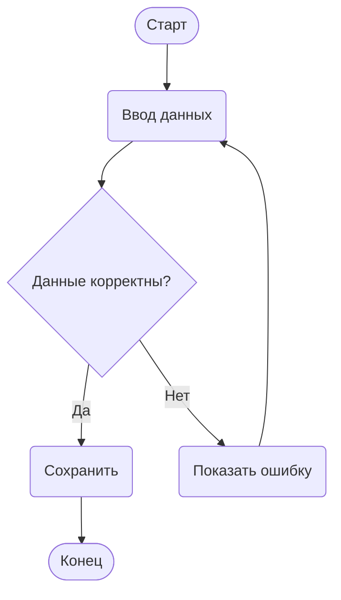

# TODO

Планы развития Birch. Каждый пункт описан так, чтобы его можно было взять в работу:
что меняется для пользователя, как это устроено внутри, какие есть спорные места
и как проверить, что всё работает.

| № | Идея | Сложность | Зависит от |
|---|---|---|---|
| 1 | [Группы-рамки](#1-группы-рамки) — ✅ готово | средняя | — |
| 2 | [Поиск и замена](#2-поиск-и-замена) — ✅ готово | низкая | — |
| 3 | [Экспорт в Mermaid](#3-экспорт-в-mermaid) — ✅ готово | низкая | лучше после 1 |
| 4 | [Рендер из командной строки](#4-рендер-из-командной-строки) — ✅ готово | средняя | лучше после 3 |
| 5 | [Английский интерфейс](#5-английский-интерфейс) | средняя | лучше последним |

**Предлагаемый порядок: 2 → 1 → 3 → 4 → 5.**

- **Поиск и замена** — самая простая задача, она ни на что не влияет.
- **Группы** меняют синтаксис, поэтому экспорт в Mermaid и командную строку стоит делать после них. Тогда группы сразу будут поддерживаться везде.
- **Перевод интерфейса** лучше делать последним, чтобы переводить уже все новые строки, а не возвращаться к нему после каждой функции.

---

## 1. Группы-рамки

> ✅ **Готово.** Сделано по этому описанию. Отличия:
> - **Подсказка «похоже, нужен блок из другого места»** срабатывает только для общих блоков. Если блок рамки упомянут один раз, а общий блок с тем же текстом есть, программа подсказывает `== (Выход)`. Для совпадения с блоком другой рамки подсказки нет: одинаковые блоки в разных рамках — обычное дело (рамки с одинаковой начинкой), и подсказка была бы ложной тревогой.
> - **Заголовок рамки — обычным, а не полужирным шрифтом.** Он чуть мельче текста блоков и приглушённого цвета. Полужирный потребовал бы отдельного шрифта для измерения текста в Graphviz.
> - **Пример с рамками** открывается через «Файл → Открыть пример с рамками».
> - **Известная особенность:** стрелка, которая входит в рамку сверху, иногда пересекает её заголовок. Так Graphviz раскладывает кластеры, и надёжно обойти это нельзя.

### Зачем

В большой схеме трудно понять, из каких частей состоит процесс. Например: авторизация, загрузка данных, обработка ошибок. Группа обводит несколько блоков рамкой с заголовком.

Если разрезать схему на несколько отдельных, пропадут стрелки между частями. С группами схема остаётся одной: стрелки свободно пересекают границы рамок.

Группы полностью **необязательны**. Если в тексте нет ни одного заголовка, схема рисуется как сейчас, и старые файлы не меняются. Стартовый пример тоже остаётся без групп.

### Синтаксис

| Запись | Значение |
|---|---|
| `=Авторизация=` на отдельной строке | открывает рамку «Авторизация»; она действует до следующего заголовка или до конца файла |
| `==` на отдельной строке | закрывает рамку; дальше идёт общая часть схемы, вне рамок |
| `[Ввод пароля]` | блок того места, где он написан: внутри рамки — блок этой рамки, вне рамок — общий блок |
| `=Загрузка= [Загрузить профиль]` | блок «Загрузить профиль» из рамки «Загрузка» |
| `== (Выход)` | общий блок «Выход» |

Фигурные скобки `{…}` уже означают ромб, поэтому запись вида `группа "Авторизация" { … }` путала бы. У записи через `=` есть и ещё один плюс: в ней нет ключевых слов на каком-либо языке. Синтаксис Birch и сейчас состоит только из скобок и символов, поэтому с английским интерфейсом (пункт 5) его не придётся переводить.

Подробности:

- **Рамка открывается и закрывается только на отдельной строке.** В строке не должно быть ничего, кроме `=Название=` или `==` (комментарий `// …` в конце допустим). Если сразу после `=Название=` или `==` в той же строке идёт блок, это уже не заголовок, а указание места блока (см. ниже).
- **Пробелы у знаков равенства.** Можно писать и вплотную, и с пробелами: `=Авторизация=` и `= Авторизация =` — одна и та же рамка. В справке и примерах основной вариант — `=Авторизация=`. Пробелы внутри названия тоже допустимы: `=Обработка ошибок=`. Двойные пробелы схлопываются, как в тексте блоков.
- **Закрытие рамки** — `==`. Запись `= =` с пробелом внутри — это заголовок без названия, и она тоже закрывает рамку.
- **Регистр важен.** `=Авторизация=` и `=авторизация=` — разные рамки, так же как сейчас различаются `[Шаг]` и `[шаг]`.
- **Особые символы в названии.** `\n` в названии даёт перенос строки, `\=` — сам знак равенства.
- **Повтор заголовка.** Тот же заголовок ещё раз продолжает ту же рамку, второй рамки не будет. Так рамку можно дописывать в разных частях файла.
- **Пустая рамка.** Рамка без блоков не рисуется.
- **Вложенность.** Её нет: рамка внутри рамки сильно усложняет синтаксис ради редкого случая.
- **Ошибки с подчёркиванием в тексте:**
  - строка вида `=Авторизация` без закрывающего `=`;
  - строка `===` и другие записи, где непонятно, где кончается название;
  - `=Название=` или `==`, после которых в той же строке идёт не блок (например, стрелка или подпись);
  - слишком длинное название (тот же лимит, что у текста блока).

### Главное правило: блок принадлежит месту, где он написан

Сейчас одинаковый текст всегда означает один и тот же блок. С рамками правило уточняется:

- **Текст внутри рамки — блок этой рамки.** В другой рамке может быть блок с таким же текстом, и это будет другой блок. Например, «Проверка ошибки» в «Авторизации» и «Проверка ошибки» в «Загрузке» — два разных блока.
- **Текст вне рамок — общий блок.** Он один на всю схему.
- **Блок из другого места указывается явно**, записью перед блоком:
  - `=Название= [Блок]` — блок из рамки «Название»;
  - `== [Блок]` — общий блок. `==` и так означает «общая часть, вне рамок», поэтому `== (Выход)` читается как «Выход из общей части».

Программа **ничего не ищет и не угадывает**. Смысл строки зависит только от неё самой и от рамки, в которой она стоит, а не от того, что написано в остальном файле.

Почему не «общие блоки видны из рамок сами, без `==`». Тогда одна дописанная строка вне рамок могла бы изменить рамки, которых никто не трогал. Пусть у «Авторизации» и «Загрузки» есть свои блоки «Проверка ошибки». Если позже дописать вне рамок `[Сохранить файл] -> {Проверка ошибки}`, появится общий блок с таким текстом, рамки начнут ссылаться на него, и их собственные проверки сольются в одну. С явным `==` такого не бывает: дописанная строка просто добавит ещё одну, отдельную проверку.

### Как соединять блоки стрелками

| Откуда → куда | Где писать | Как |
|---|---|---|
| внутри одной рамки | в этой рамке | как обычно: `[A] -> [B]` |
| из рамки в общий блок | в рамке | `[A] -> == (Выход)` |
| из рамки в другую рамку | в любой из двух рамок | `[A] -> =Загрузка= [B]` |
| между общими блоками | вне рамок | как обычно: `[A] -> [B]` |
| из общего блока в рамку | вне рамок | `[A] -> =Загрузка= [B]` |

Пример:

```
=Авторизация=
[Ввод пароля] -> {Проверка ошибки}
{Проверка ошибки} -> == (Выход) "Ошибка"                          // в общий блок
[Ввод пароля] -> =Загрузка= [Загрузить профиль] "Вход выполнен"   // в другую рамку

=Загрузка=
[Загрузить профиль] -> {Проверка ошибки}
{Проверка ошибки} -> == (Выход) "Ошибка"                          // в тот же общий блок
```

Результат — два разных блока «Проверка ошибки», по одному в каждой рамке, и один общий «Выход»:

```
┌─ Авторизация ──────┐       ┌─ Загрузка ──────────┐
│ [Ввод пароля] ─────┼──────→│ [Загрузить профиль] │
│       ↓            │       │        ↓            │
│ {Проверка ошибки}  │       │ {Проверка ошибки}   │
└───────┼────────────┘       └────────┼────────────┘
        │ Ошибка                      │ Ошибка
        └──────────→ (Выход) ←────────┘
```

Отдельно объявлять «Выход» вне рамок не нужно: запись `== (Выход)` сама создаёт общий блок. Закрывать последнюю рамку перед ним тоже не нужно.

**Рамки с одинаковой начинкой**, которые отличаются только названием, соединяются так же:

```
=Попытка 1=
[Ввод пароля] -> {Проверка ошибки}
{Проверка ошибки} -> =Попытка 2= [Ввод пароля] "Ещё раз"

=Попытка 2=
[Ввод пароля] -> {Проверка ошибки}
```

```
┌─ Попытка 1 ─────────┐          ┌─ Попытка 2 ─────────┐
│ [Ввод пароля]       │   ┌─────→│ [Ввод пароля]       │
│       ↓             │   │      │       ↓             │
│ {Проверка ошибки} ──┼───┘      │ {Проверка ошибки}   │
└─────────────────────┘ Ещё раз  └─────────────────────┘
```

Подробности:

- **Указание относится только к одному блоку** — тому, что идёт сразу после него. Остальные блоки строки — блоки того места, где написана строка.
- **Пробелы допустимы**, как и в заголовке: `= Попытка 2 = [Ввод пароля]`, `==(Выход)`.
- **Указание своей рамки** (`=Авторизация= [X]` внутри «Авторизации») допустимо и ничего не меняет.
- **Порядок строк не важен.** Стрелку в рамку можно написать до самой рамки, а общий блок можно упомянуть через `==` раньше, чем вне рамок.
- **Фигура блока.** Правило «если блок хоть раз записан как `{…}` или `(…)`, он остаётся этой фигурой» работает для каждого блока отдельно. Ромб «Проверка» в одной рамке не делает ромбом блок «Проверка» в другой.

### Ошибки и подсказки

- **Рамка не найдена.** Если в указании `=Название= [Блок]` рамки с таким названием нигде в файле нет, строка подчёркивается ошибкой. Чаще всего так выглядит попытка открыть рамку и сразу написать в ней стрелку в одну строку:

  ```
  =Попытка 1= [Ввод пароля] -> {Проверка ошибки}
  ```

  Подсказка: «Рамка «Попытка 1» не найдена. Рамка открывается на отдельной строке: `=Попытка 1=`».

- **Похоже, нужен блок из другого места.** Если внутри рамки написан блок, текст которого есть в другой рамке или среди общих блоков, а в этой рамке он больше нигде не используется, редактор показывает подсказку (не ошибку): «Блок «Выход» есть среди общих блоков. Чтобы провести стрелку туда, напишите `== (Выход)`». Так забытое `==` или `=Название=` не останется незамеченным.

### Внешний вид

- **Рамка.** Тонкая и скруглённая, слегка подкрашенный фон, заголовок в левом верхнем углу мелким полужирным шрифтом.
- **Светлая и тёмная тема.** Рамка и фон в приглушённых цветах темы, чтобы не спорить с цветами блоков.
- **Чёрно-белый режим.** Чёрная рамка, белый фон, чёрный заголовок.
- **Горизонтальная схема.** Работает так же.
- **Редактор.** `=Название=` и `==` подсвечиваются отдельным цветом — и в заголовках, и в указаниях перед блоком, — чтобы структура файла была видна сразу.

### Как устроено

- **Парсер (`src/core/Parser.cpp`).**
  - Нужен новый токен `=Название=` (включая `==` с пустым названием); пробелы между знаками и названием отбрасываются.
    - Если в строке больше ничего нет (кроме комментария) — это заголовок: `=Название=` открывает рамку, `==` и `= =` закрывают её.
    - Если сразу после него идёт блок — это указание места этого блока.
    - Если после него идёт что-то другое — ошибка.
  - Каждый блок определяется сразу при разборе: текущая рамка, если указания нет, иначе рамка из указания или общая часть для `==`. Поиска по файлу нет.
  - Существование рамок из указаний проверяется после разбора всего файла, чтобы порядок строк был не важен.
- **Модель (`src/core/Diagram.h`).**
  - В `Diagram` появляется список рамок: название и порядок появления.
  - В `Node` появляется индекс рамки, где `-1` означает общий блок.
  - Блок определяется парой «рамка + текст», а не одним текстом. Его внутренний идентификатор в Graphviz тоже строится из пары, иначе два блока «Проверка ошибки» склеятся.
- **Рендер (`src/core/Renderer.cpp`).** Каждая рамка становится подграфом Graphviz с именем `cluster_N`. Graphviz сам держит блоки кластера вместе и рисует рамку. Задаются атрибуты `label`, `labeljust=l`, `style="rounded,filled"`, а цвета рамки и фона берутся из `Theme`.
- **Тема (`src/core/Theme.*`).** Новые цвета: рамка, фон и заголовок рамки, отдельно для светлой, тёмной и чёрно-белой тем.
- **Подсветка синтаксиса в редакторе.** Нужно новое правило для `=Название=` и `==`.
- **Документация.** Нужна строка в справке «Синтаксис…» и в README, а также отдельный пример с рамками.

### Спорные места

- **Компактность.** С кластерами Graphviz иногда раскладывает схему менее плотно. Это нужно проверить на нескольких реальных схемах и при необходимости подобрать отступы (`margin` у кластера).
- **Длина строк.** Стрелки в общие блоки и в другие рамки длиннее: `-> == (Выход)` вместо `-> (Выход)`. Это цена за то, что строка всегда значит одно и то же. Если на реальных схемах это окажется утомительным, можно вернуться к вопросу, но не за счёт угадывания.

### Проверка

- Тесты парсера:
  - одинаковый текст в двух рамках даёт два блока;
  - текст вне рамок — общий блок;
  - `== (Выход)` из двух рамок ведёт в один и тот же общий блок;
  - `== (Выход)` создаёт общий блок, даже если вне рамок его нет;
  - общий блок с тем же текстом, что у блоков рамок, не сливается с ними;
  - `=Загрузка= [Блок]` из другой рамки и из общей части;
  - стрелка между рамками с одинаковой начинкой;
  - стрелка в рамку, написанная раньше самой рамки;
  - указание относится только к следующему блоку;
  - указание своей рамки ничего не меняет;
  - ошибка «рамка не найдена» с подсказкой про отдельную строку;
  - подсказка «похоже, нужен блок из другого места»;
  - фигура блока не переходит в другую рамку;
  - `=Название=` и `= Название =` — одна и та же рамка; `==` и `= =` закрывают рамку;
  - пробелы внутри названия допустимы, двойные схлопываются;
  - разный регистр — разные рамки;
  - `=Название=` или `==` со стрелкой в той же строке — ошибка; с комментарием — заголовок;
  - `===` — ошибка;
  - повторный заголовок продолжает рамку;
  - пустая рамка;
  - ошибка незакрытого заголовка;
  - файл без рамок разбирается как раньше.
- Тесты рендера: в SVG есть кластеры с нужными названиями, а два одноимённых блока из разных рамок не склеены.
- Снимки окна в CI в светлой, тёмной и чёрно-белой темах на примере с рамками.

---

## 2. Поиск и замена

> ✅ **Готово.** Сделано по этому описанию. Отличия:
> - **Клавиши перехода.** «Следующее / предыдущее совпадение» на Windows и Linux — и F3 / Shift+F3, и Ctrl+G / Ctrl+Shift+G (стандартные клавиши Qt зависят от оболочки Linux).
> - **Меню «Правка».** Кроме «Отменить» и «Повторить», в нём есть «Вырезать», «Копировать», «Вставить» и «Выбрать все».
> - **Замена с регулярными выражениями.** `$1`, `$2`… — группы, `$0` — всё совпадение, `$$` — сам `$`, `\n` — перенос строки.
> - **Без подписей «Найти:» и «Заменить:».** Они стали подсказками внутри полей, чтобы панель помещалась в узкую левую часть окна (на Windows она по умолчанию около 380 пикселей).
> - **Без красного поля на macOS.** Родной стиль macOS рисует поле ввода сам, поэтому там «Не найдено» видно только в счётчике.

### Зачем

В редакторе нет поиска совсем. Самый частый случай — переименовать блок. Одинаковый текст означает один и тот же блок, поэтому название нужно поменять во всех строках сразу, иначе схема развалится на два разных блока.

### Как выглядит

Под редактором появляется панель, как в VS Code или браузере, а не отдельное окно. Окно мешает видеть текст.

```
┌──────────────────────────────────────────────────────────────┐
│ Найти:    [Ввод данных         ]  3 из 7   ↑  ↓   Aa  .*   ✕ │
│ Заменить: [Ввод информации     ]  [Заменить] [Заменить все]  │
└──────────────────────────────────────────────────────────────┘
```

- Найденные совпадения подсвечиваются во всём тексте, текущее выделено ярче.
- Счётчик показывает «3 из 7» или «Не найдено», а поле при этом слегка краснеет.
- Поиск идёт сразу при наборе.
- Есть переключатели: «Учитывать регистр» (`Aa`) и «Регулярное выражение» (`.*`).
- «Заменить все» — одно действие отмены: одно нажатие ⌘Z / Ctrl+Z возвращает всё как было.
- Если перед открытием панели был выделен текст, он сразу подставляется в поле «Найти».

### Горячие клавиши

| Действие | macOS | Windows, Linux |
|---|---|---|
| Найти | ⌘F | Ctrl+F |
| Найти и заменить | ⌥⌘F | Ctrl+H |
| Следующее совпадение | ⌘G или Enter | F3 или Enter |
| Предыдущее совпадение | ⇧⌘G или ⇧Enter | Shift+F3 или Shift+Enter |
| Закрыть панель | Esc | Esc |

Пункты «Найти…» и «Заменить…» появятся в меню «Правка». Если такого меню ещё нет, его нужно добавить, перенеся туда «Отменить» и «Повторить».

### Как устроено

- Новый виджет `src/ui/FindBar.*`: поля, кнопки, счётчик.
- **Поиск.** Используется `QTextDocument::find` с флагами регистра; для регулярных выражений — `QRegularExpression`.
- **Подсветка.**
  - Совпадения подсвечиваются через `QTextEdit::ExtraSelection`.
  - Подчёркивание ошибок тоже сделано через extra selections, поэтому `CodeEditor` должен объединять оба списка, иначе одно затрёт другое.
- **Замена всех.** Выполняется внутри одного `QTextCursor::beginEditBlock()` / `endEditBlock()`, чтобы получилось одно действие отмены.
- **Перерисовка схемы.** После замены схема перерисовывается как после обычного набора, через тот же таймер на 300 мс.

### Проверка

- Тесты на `CodeEditor`/`FindBar`:
  - счётчик совпадений;
  - переход по кругу (после последнего — первое);
  - «Заменить все» и одна отмена;
  - некорректное регулярное выражение показывает ошибку, а не падает.

---

## 3. Экспорт в Mermaid

> ✅ **Готово.** Сделано по этому описанию. Отличия:
> - **Экранируется и `#`** (как `#35;`): в Mermaid с него начинаются коды символов, и текст вроде `#1;` иначе исчез бы.
> - **«Экспорт Mermaid…» сохраняет чистый текст Mermaid** в файл `.mmd`, а «Копировать как Mermaid» — тот же текст в блоке ` ```mermaid `, готовый для Markdown.
> - **Проверка в CI** — на macOS: тест сохраняет экспорт примеров, включая особые символы и рамки, а `mermaid-cli` 11.17.0 рисует каждый файл; картинки доступны в артефакте `mermaid`.

### Зачем

[Mermaid](https://mermaid.js.org) — текстовый формат схем, который отображается сам:
- на GitHub в README, issues и pull requests;
- в GitLab;
- в Notion;
- в Obsidian;
- в Confluence (через плагин);
- во многих вики.

Экспорт позволит нарисовать схему в Birch и вставить её туда не картинкой, а текстом. Такую схему можно потом поправить прямо там, и она подстраивается под тему сайта.

### Как выглядит

- **«Файл → Экспорт Mermaid…»** сохраняет файл `.mmd`.
- **«Копировать как Mermaid»** кладёт в буфер текст, уже обёрнутый в блок ` ```mermaid … ``` `. Его можно сразу вставить в Markdown.

Пример. Схема Birch:

```
(Старт) -> [Ввод данных] -> {Данные корректны?}
{Данные корректны?} -> [Сохранить] "Да" -> (Конец)
{Данные корректны?} -> [Показать ошибку] "Нет" -> [Ввод данных]
```

превращается в:



### Соответствие

| Birch | Mermaid |
|---|---|
| `[Текст]` — шаг | `n1("Текст")` — скруглённый прямоугольник |
| `{Текст}` — условие | `n1{"Текст"}` — ромб |
| `(Текст)` — начало или конец | `n1(["Текст"])` — «таблетка» |
| `->` и подпись | `-->` и `-->\|"подпись"\|` |
| горизонтальная схема | `flowchart LR` вместо `flowchart TD` |
| рамка `=Название=` (пункт 1) | `subgraph g1["Название"] … end` |

### Как устроено

- Новый модуль `src/core/MermaidExporter.*`: функция, которая получает `Diagram` и возвращает текст. Ей не нужны ни Qt Widgets, ни Graphviz, поэтому её легко тестировать.
- **Идентификаторы блоков** — `n1`, `n2`, … в порядке появления. Текст блоков может содержать что угодно, поэтому сам текст в идентификатор не годится.
- **Экранирование.**
  - Текст всегда заключается в кавычки.
  - Кавычка `"` заменяется на `#quot;`.
  - Перенос `\n` заменяется на `<br/>`.
  - Символы `<`, `>` и `&` экранируются, чтобы Mermaid не принял их за разметку.
- **Цвета не переносятся.** Mermaid раскрашивает схему по теме сайта, и это правильно: на GitHub в тёмной теме схема сама станет тёмной.
- **Раскладка.** Mermaid раскладывает схему сам, поэтому картинка будет похожей, но не точно такой же, как в Birch.

### Проверка

- Юнит-тесты экспортёра:
  - все три фигуры;
  - подписи;
  - экранирование кавычек, переносов и `<>&`;
  - горизонтальная схема;
  - группы.
- В CI: проверка экспортированного примера официальным `mermaid-cli` (`npx @mermaid-js/mermaid-cli`), который должен отрисовать его без ошибок. Это проверка только в CI, на компьютер ничего не ставится.

---

## 4. Рендер из командной строки

> ✅ **Готово.** Сделано по этому описанию. Отличия:
> - **Пометка в сообщениях.** Перед текстом стоит `ошибка:` или `предупреждение:`, как у компиляторов: `схема.birch:1:8: ошибка: Не закрыта скобка «[»…`. Предупреждения печатаются, но картинку не отменяют.
> - **Файл при ошибках не создаётся.** Если в схеме есть ошибки, старый файл остаётся нетронутым, а новый не появляется (запись через временный файл). Так в Makefile не останется картинки от неудачной сборки.
> - **Пустая схема — код `1`** с сообщением «схема пуста — нечего рисовать».
> - **Масштаб — от 1 до 10.** Больше 10 картинка выходит огромной, а рисуется долго.
> - **Справка и версия — вообще без `QCoreApplication`.** Ключи разбираются до создания приложения.
> - **Windows — без offscreen.** У платформы offscreen на Windows нет системных шрифтов, поэтому рендер идёт на обычной платформе (окно всё равно не создаётся). На macOS в бандл добавлен плагин offscreen, на Linux при локали «C» берётся C.UTF-8.
> - **Фон SVG.** Цвет фона теперь записан в самом SVG, а не только в PNG. Заодно «Экспорт SVG» в окне учитывает «Прозрачный фон».
> - **Автор в `--version`** — Marth Scoobert.

### Зачем

Получить картинку из файла `.birch` без открытия окна:
- в скриптах;
- при сборке документации, например из `docs/*.birch` в `docs/*.svg`;
- в CI;
- в Makefile.

Тогда схемы можно хранить в репозитории как текст, а картинки генерировать автоматически.

### Как выглядит

```bash
birch схема.birch -o схема.png                 # формат по расширению
birch схема.birch -o схема.svg
birch схема.birch -o схема.mmd                 # Mermaid (пункт 3)
birch схема.birch -o схема.png --theme dark --scale 3
birch схема.birch -o схема.png -t dark -s 3    # то же короткими ключами
birch схема.birch -o схема.png --monochrome --transparent
birch схема.birch -o схема.png -ma             # то же: короткие ключи можно склеивать
birch схема.birch -o схема.png --horizontal
cat схема.birch | birch - -o схема.svg         # чтение из stdin
birch --help                                   # справка
birch --version                                # версия
```

| Ключ | Значение | По умолчанию |
|---|---|---|
| `-o, --output=ФАЙЛ` | куда сохранить; формат по расширению `.png`, `.svg` или `.mmd` | — |
| `-t, --theme=ТЕМА` | тема: `light` или `dark` | `light` |
| `-m, --monochrome` | чёрно-белая схема | выкл. |
| `-H, --horizontal` | схема слева направо | выкл. |
| `-a, --transparent` | прозрачный фон (PNG и SVG) | выкл. |
| `-s, --scale=N` | масштаб PNG: 1, 2, 3… | `2` |
| `-h, --help` | показать справку и выйти | — |
| `-v, --version` | показать версию и выйти | — |

Пояснения к коротким ключам:
- **`-H` — заглавная**, потому что `-h` занят справкой.
- **`-a` — от «alpha»**, прозрачности. `-t` уже занят темой, а `-T` рядом с ним легко перепутать.
- **Значение можно писать** и через `=`, и через пробел: `--theme=dark`, `--theme dark`, `-t dark`, `-tdark`.
- **Короткие ключи без значения можно склеивать:** `-ma` — то же, что `-m -a`.

**Только вместе с `-o`.** Ключи `-t`, `-m`, `-H`, `-a` и `-s` задают вид картинки и имеют смысл только вместе с `-o`. Без `-o` программа не игнорирует их молча, а сообщает об ошибке (код `3`), чтобы было понятно, почему окно не изменилось:

```
birch: ключ «--theme» работает только вместе с -o
Попробуйте «birch --help» для получения дополнительной информации.
```

Тему окна и чёрно-белую схему в окне по-прежнему выбирают в меню.

**Служебные ключи переименовываются.** Сейчас у программы есть скрытые ключи `--theme` и `--monochrome`, с которыми CI делает снимки окна. Чтобы `--theme` означал только тему картинки, они становятся `--screenshot-theme` и `--screenshot-monochrome`. Они по-прежнему скрыты, нужны только CI и в справку не попадают.

### Справка и версия

`--help` и `--version` выводят текст в стандартный вывод (stdout) и сразу завершаются с кодом `0`. Окно при этом не открывается и графика не нужна: они работают и на сервере без экрана. Если вместе с ними указаны другие ключи, те не выполняются.

Формат — как у программ GNU ([GNU Coding Standards, «--help» и «--version»](https://www.gnu.org/prep/standards/html_node/Command_002dLine-Interfaces.html)).

**`birch --help`:**

```
Использование: birch [ПАРАМЕТР]... [ФАЙЛ]
Открывает ФАЙЛ (.birch) в редакторе или, с ключом -o, рисует по нему
блок-схему в файл, не открывая окна.
Если ФАЙЛ — «-», текст схемы читается со стандартного ввода.

Аргументы, обязательные для длинных ключей, обязательны и для коротких.
  -o, --output=ФАЙЛ        сохранить схему в ФАЙЛ и выйти; формат по
                             расширению: .png, .svg или .mmd (Mermaid)
  -t, --theme=ТЕМА         тема: light (по умолчанию) или dark
  -m, --monochrome         чёрно-белая схема
  -H, --horizontal         располагать блоки слева направо
  -a, --transparent        прозрачный фон (PNG и SVG)
  -s, --scale=N            масштаб PNG: 1, 2, 3… (по умолчанию 2)
  -h, --help               показать эту справку и выйти
  -v, --version            показать информацию о версии и выйти

Примеры:
  birch схема.birch                       открыть схему в редакторе
  birch схема.birch -o схема.png          нарисовать схему в PNG
  birch -t dark -s 3 схема.birch -o схема.png
  cat схема.birch | birch - -o схема.svg

Коды выхода:
  0  успешно
  1  в тексте схемы есть ошибки
  2  ошибка чтения или записи файла
  3  неверные ключи командной строки

Домашняя страница: <https://github.com/empmaynmtusrgdyt/Birch>
Об ошибках сообщайте: <https://github.com/empmaynmtusrgdyt/Birch/issues>
```

**`birch --version`:**

```
birch (Birch) 0.6.0
Copyright (C) 2026 авторы Birch.
Лицензия GPLv3: GNU GPL версии 3 <https://gnu.org/licenses/gpl.html>
с дополнительным разрешением для Graphviz (см. LICENSE-EXCEPTION).
Это свободное ПО: вы можете изменять и распространять его.
НИКАКИХ ГАРАНТИЙ не предоставляется в пределах, допускаемых законом.

Используются: Qt 6.8.3, Graphviz 16.1.0
```

Правила оформления, как в GNU:

- **Первая строка `--version`** — `программа (пакет) версия`. Её разбирают скрипты, поэтому формат не меняется.
- **Версии Qt и Graphviz** — те, что реально загружены при запуске (`qVersion()` и версия из Graphviz), а не те, с которыми программа собиралась. Это помогает разбирать сообщения об ошибках.
- **Имя программы в `Использование:`** — то, под которым её запустили. Например, `birch` по ссылке из `/usr/local/bin` на macOS, а не `Birch`.
- **Строки не длиннее 80 символов**, описания ключей выровнены в одну колонку, перенос описания — с отступом.
- **Служебные ключи** `--screenshot`, `--screenshot-theme`, `--screenshot-monochrome` и `--find` в справку не попадают.
- **Неверный ключ** — сообщение в stderr и код `3`, как в GNU:

  ```
  birch: неизвестный ключ «--colour»
  Попробуйте «birch --help» для получения дополнительной информации.
  ```

  Так же для ключа без обязательного значения (`birch -o`), неверного значения (`--theme=blue`, `--scale=0`) и ключа вида картинки без `-o`.

**Коды выхода.** Они нужны скриптам:

| Код | Значение |
|---|---|
| `0` | готово |
| `1` | ошибки в тексте схемы; каждая выводится в stderr в виде `схема.birch:4:12: Не закрыта скобка «[»` (формат понимают редакторы и CI) |
| `2` | ошибка ввода-вывода: файл не найден, нет прав на запись и т. п. |
| `3` | неверные ключи |

Без `-o` программа открывается как обычно, поэтому `birch схема.birch` по-прежнему открывает файл в окне.

### Как устроено

- **Где живёт код.** Разбор ключей уже есть в `src/main.cpp` (`QCommandLineParser`), туда добавляется режим `-o`. В этом режиме окно не создаётся: парсер, рендер и запись файла вызываются напрямую.
- **Нужна ли графика.** Размер текста в блоках измеряется через `QFontMetricsF`, поэтому нужен `QGuiApplication`, но не окно. Для этого платформа `offscreen` включается программно до создания приложения. Тогда программа работает и на сервере без экрана (Linux в CI, SSH), без `xvfb` и `QT_QPA_PLATFORM`.
- **Windows.** `Birch.exe` собран как оконное приложение, и у него нет консоли: вывод в stderr пропадает. Решение — в режиме `-o` вызывать `AttachConsole(ATTACH_PARENT_PROCESS)`, чтобы сообщения появлялись в окне `cmd` или PowerShell, из которого запущена программа.
- **macOS.** Команда запускается как `/Applications/Birch.app/Contents/MacOS/Birch …`. В README стоит описать, как сделать короткую команду `birch` через `ln -s` в `/usr/local/bin`.
- **Linux.** Команда `birch` уже доступна после установки `.deb` или пакета Arch.
- **Общий код с окном.** Сохранение PNG и SVG сейчас живёт в `MainWindow`. Его нужно вынести в `src/core`, чтобы окно и командная строка использовали один код и картинки совпадали байт в байт.
- **Справка и версия.** Встроенные `addHelpOption()` и `addVersionOption()` из `QCommandLineParser` не подходят: их вывод не в формате GNU, к тому же они добавляют `--help-all`, `-?` на Windows и служебные ключи Qt. Поэтому `-h` и `-v` объявляются как обычные ключи, а текст справки и версии печатается свой. Разбирает ключи по-прежнему `QCommandLineParser`: он уже умеет `--ключ=значение`, склеенные короткие ключи и `--` перед именами файлов, начинающимися с `-`.
- **Без графики для справки.** `--help` и `--version` обрабатываются до создания `QApplication`, на `QCoreApplication`. Поэтому они работают мгновенно и там, где нет экрана и платформенных плагинов.
- **Windows.** Для `--help` и `--version` так же вызывается `AttachConsole(ATTACH_PARENT_PROCESS)`, иначе их вывод в `cmd` или PowerShell не увидеть.

### Проверка

- В CI на всех системах:
  - `--help` и `-h`, `--version` и `-v`: код `0`, вывод в stdout, короткая и длинная формы дают одинаковый текст;
  - первая строка `--version` — `birch (Birch) <версия из CMakeLists.txt>`;
  - строки `--help` не длиннее 80 символов;
  - неизвестный ключ: код `3`, подсказка про `--help` в stderr;
  - `-t`, `-m`, `-H`, `-a`, `-s` без `-o`: код `3`, сообщение «работает только вместе с -o»;
  - снимки окна в CI переведены на `--screenshot-theme` и `--screenshot-monochrome`;
  - короткие и длинные ключи дают одинаковые картинки (`-t dark -m` и `--theme=dark --monochrome`);
  - рендер примера в PNG, SVG и MMD;
  - проверка кодов выхода: правильный файл, файл с ошибкой, несуществующий файл;
  - текст ошибки в stderr.
- На Linux проверяется отдельно, что всё работает без `xvfb` и без переменной `QT_QPA_PLATFORM`.

---

## 5. Английский интерфейс

### Зачем

Репозиторий публичный, но интерфейс, сообщения об ошибках и справка только на русском. Английский откроет Birch для остальных пользователей.

### Как выглядит

- **Выбор языка.** Язык выбирается по системе: русский — на системе с русским языком, иначе английский. В меню «Вид → Язык» можно выбрать вручную: «Как в системе», «Русский», «English». Выбор запоминается и применяется после перезапуска, о чём программа сообщает.
- **Что переводится:**
  - меню, кнопки и подсказки;
  - сообщения об ошибках в тексте схемы;
  - справка о синтаксисе;
  - окно «О программе»;
  - стандартные диалоги Qt (кнопки «Сохранить», «Отмена» и т. п.).
- **Синтаксис не меняется.** Он состоит из скобок и символов, поэтому файлы `.birch` одинаковы на любом языке.
- **Стартовый пример.** У каждого языка свой: `welcome.birch` и `welcome.en.birch`.

### Как устроено

- **Переводы Qt Linguist:**
  - в CMake добавляется `qt_add_translations` и файл `translations/birch_en.ts`;
  - при сборке он превращается в `.qm` и встраивается в ресурсы.
- **Исходный язык.** Строки интерфейса уже обёрнуты в `tr()`, и исходным языком остаётся русский.
- **Ошибки парсера.** В `src/core/Parser.cpp` сообщения написаны через `QStringLiteral`, их нужно перевести на `QCoreApplication::translate`.
- **Загрузка перевода.** В `main.cpp` через `QTranslator` по `QLocale::system().uiLanguages()` с учётом ручного выбора из настроек.
- **Стандартные диалоги Qt.** Нужно загружать `qtbase_*.qm` и проверить, что `windeployqt`, `macdeployqt` и `linuxdeploy` кладут их в пакеты.
- **macOS.** В `Info.plist` нужен `CFBundleLocalizations` (ru, en), иначе системные пункты меню («Службы», «Скрыть») не переведутся.
- **Windows.** Установщик NSIS тоже на двух языках.
- **Linux.** В `birch.desktop` добавляется `Name[en]` и `Comment[en]`, в `birch-mime.xml` — английское описание типа файла.
- **README.** Появляется `README.en.md` со ссылкой на него в начале русского README и наоборот.

### Спорные места

- **Поддержка перевода.** Каждую новую строку интерфейса придётся переводить. В CI стоит добавить проверку, что в `birch_en.ts` нет непереведённых строк (`lupdate` + проверка `type="unfinished"`), иначе перевод быстро устареет.
- **Ширина элементов.** Английский текст обычно короче русского, но подписи на панели инструментов всё равно нужно проверить на снимках, чтобы ничего не обрезалось.

### Проверка

- Снимки окна в CI на обоих языках: скрытый ключ `--language en`, по аналогии с `--theme`.
- Тест, что сообщения парсера переводятся.
- Проверка в CI на непереведённые строки.
